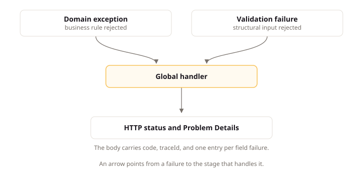

# HTTP API

## Intent

The WebApi project is the thin HTTP boundary of a LiteSpec backend: it converts each HTTP request into a message for the Application layer, dispatches it, and maps the result back to a stable HTTP response. This page states what one endpoint owns, how routes, errors, and collection paging behave, and how the OpenAPI contract, the machine-readable description of the API, is generated from the code. Keeping business rules, storage, and provider calls out of endpoints keeps HTTP replaceable transport, so the API evolves without touching business behavior.

## Concepts

### Endpoints as Transport Adapters

An endpoint does three things and nothing else: it converts HTTP input to an Application message, dispatches that message through its mediator, and maps the result to the HTTP response. One endpoint class serves one route operation. Business rules, persistence access, provider calls, and error mapping all live outside endpoints: the handler owns behavior, the guard owns target authorization, and one global handler owns error responses.

### Errors as Problem Details

Every error response uses RFC 9457 Problem Details carrying a stable application `code`, the current `traceId`, and one `errors` entry per field failure. The stable code lets a client branch on the failure, and the trace identifier connects the response to its diagnostics. Error responses come from one global handler that maps each failure to its status and body.

### The Generated Contract

The OpenAPI document is generated from the code during the Release build, with no handwritten copy. It declares each operation's stable `operationId`, authorization, request, success, and Problem Details metadata, plus precise schemas for every field. The generated artifact is committed when a frontend or external consumer reads it, so every contract change is visible in review.

## Standards

### Map One Operation per Endpoint

**Statement:** An endpoint MUST map one route operation, convert input to an Application message, dispatch through its mediator, and map the result.

**Rationale:** One endpoint class per route operation gives each route a single owner, so its input mapping, dispatch, and result mapping live in one place. An endpoint that served several operations would mix their mappings and force one class to change for unrelated routes.

**Example:** At startup, the application discovers endpoint implementations, registers each one once, and maps them in deterministic name order. Discovery uses the platform's own reflection and dependency injection. It needs no separate scanning package.

### Keep Endpoint Dependencies Transport-Focused

**Statement:** An endpoint MUST NOT take an aggregate repository, a persistence session or context, a provider client, or an application service.

**Rationale:** An endpoint that took a repository, session, provider, or application service could reach business state or providers without passing the pipeline. Endpoints hold no request-scoped dependency because the application registers them at startup; handlers take mediators and HTTP-boundary services such as an actor accessor.

### Defer Error Mapping to the Global Handler

**Statement:** An endpoint MUST NOT catch a use-case failure, a domain failure, or a validation failure.

**Rationale:** One global handler produces every error response from every failure type. An endpoint that caught a failure would create a second mapping for the same failure, and the two would diverge: the same refusal would answer different statuses or codes depending on which endpoint raised it.

### Apply Only Coarse Policies at the Endpoint

**Statement:** A WebApi endpoint MUST enforce only coarse authenticated, role, or scope policies, leaving target decisions to the application guard.

**Rationale:** Authentication establishes who is calling, not whether the caller is allowed to act on this specific resource. Coarse policies at the endpoint check the caller; the application guard decides the target from the permissions the use case needs. An endpoint that decided target authorization would duplicate business data access the guard already owns. Target authorization lives in `litespec/backend/application#enforce-target-authorization-in-the-pipeline`.

An operation applies a stable forbidden or not-found policy when revealing that a resource exists would leak information.

### Return Stable Problem Details

**Statement:** An error response MUST use [RFC 9457](https://datatracker.ietf.org/doc/html/rfc9457) Problem Details carrying a stable application `code`, the current `traceId`, and an `errors` entry for each field failure.

**Rationale:** A stable machine-readable code lets a client branch on the failure without parsing prose, and the trace identifier connects the response to its diagnostics. One entry per field failure tells the caller everything wrong with the request in one answer. RFC 9457 defines the Problem Details media type the contract uses.

**Example:** The serialized contract is:

```json
{
  "type": "https://example.test/problems/validation",
  "title": "Request validation failed",
  "status": 400,
  "detail": "One or more values are invalid.",
  "instance": "/api/posts",
  "code": "validation-failed",
  "traceId": "4bf92f3577b34da6a3ce929d0e0e4736",
  "errors": [
    {
      "field": "title",
      "code": "required",
      "message": "Title is required."
    }
  ]
}
```

`type` is a stable absolute URI owned by the consumer. `errors` appears only when validity findings exist, carrying their member, code, and message. `code` carries the refusal result's stable code, and `detail` carries the free-form prose explanation. A request body names the same pair `code` and `reason` under `litespec/backend/api#name-failure-pairs-code-and-reason`.

WebApi maps Application member names to their public JSON field names. `traceId` carries the trace identifier from the current [W3C Trace Context](https://www.w3.org/TR/trace-context/) `traceparent`, with the request identifier as fallback. The same shape applies to authentication and authorization failures.

The global handler maps validation failures to 400, missing targets through the operation's disclosure policy, and forbidden failures to 403 or the declared 404. It maps conflicts and state rejections to 409, and unexpected failures to 500 with code `internal-error`. It maps each known domain failure individually. It does not report cancellation from a disconnected request as an application error.

In the Claimwick product, reimbursing an expense that is not approved ends with `result/reimburse-expense.not-approved`, which carries the code `spending.not-approved` and the status 409. For example, the global handler answers:

```json
{
  "type": "https://example.test/problems/conflict",
  "title": "Not approved",
  "status": 409,
  "detail": "The expense is not approved.",
  "instance": "/api/expenses",
  "code": "spending.not-approved",
  "traceId": "4bf92f3577b34da6a3ce929d0e0e4736"
}
```

The endpoint catches no failure. The diagram shows how a domain failure or a validation failure reaches the global handler and becomes a status with a Problem Details body.



### Use Consistent Status Codes

**Statement:** A WebApi operation MUST return the status the outcome table assigns to its result.

**Rationale:** A client branches on status before it reads a body, so a status that disagrees with the outcome table hides the real outcome. The stack derives the status from the use-case result: each success and refusal kind maps to exactly one status, with no recorded status on the record. The outcome table assigns each result its status once, and the operation returns exactly that status.

**Example:**

| Outcome | Status |
|:---|:---:|
| Successful read | 200 |
| Successful creation of a readable resource | 201 with the resource location |
| Successful creation without a read route | 201 |
| Successful command without a response body | 204 |
| Structural validation failure | 400 |
| Missing or invalid authentication | 401 |
| Authenticated but forbidden | 403 |
| Resource unavailable under the disclosure policy | 404 |
| State, version, or idempotency conflict | 409 |
| Accepted background operation | 202 with status location |
| Unexpected failure | 500 |

### Require the Marker Header on Cookie-Authenticated Writes

**Statement:** The API MUST refuse a cookie-authenticated write without the project's marker header.

**Rationale:** Cookies travel with every request, including ones a malicious page triggers, so a cookie-authenticated write needs proof the project's own page sent it. A page on another site adds no custom header, so the header's absence exposes a cross-site forgery. A write is any request other than GET, HEAD, or OPTIONS. The header takes the form `X-<Project>-Request: 1`, with the exact name set in project configuration.

The refused request is unauthenticated, so it answers 401 under `litespec/backend/api#use-consistent-status-codes`. The frontend pages own sending the header. This rule owns the API refusal.

### Keep Routes Resource-Oriented

**Statement:** A route MUST use lowercase plural resource segments, kebab-case subresources, route parameters for identity, query parameters for filtering, and the body for command data.

**Rationale:** A predictable route shape lets a caller derive an unfamiliar operation from a familiar one: plural resource segments, kebab-case subresources, route parameters for identity, query parameters for filtering, and command data in the body. A route that encoded actions or identities anywhere else would force the caller to read each route's documentation.

**Example:** A route carries the authenticated actor identifier only when that actor is intentionally addressing another actor as a resource.

### State an Unexpressible Transition as a Custom Method

**Statement:** A WebApi route MUST express a state transition the five HTTP verbs cannot carry as a POST custom method ending in a colon-suffixed verb.

**Rationale:** Some transitions fit no standard verb, and stuffing them into one overloads its meaning. The custom-method form marks the final segment as a command rather than a nested resource: a path segment names a resource, while a state-noun segment such as `/closure` and a bare verb segment such as `/abandon` both encode the action without predicting each other. [AIP-136](https://google.aip.dev/136) defines this form.

**Example:**

```text
POST /api/shipments/{shipmentId}:cancel
POST /api/merchants/{merchantId}:close
POST /api/orders/{orderId}/refund-requests/{refundId}:decide
```

The `operationId` keeps its verb-noun form, so `CancelShipment` names the same transition the path states.

### Apply PATCH to a Partial Update

**Statement:** A WebApi operation MUST apply a partial update with PATCH and the `application/merge-patch+json` media type.

**Rationale:** A partial update names only the fields it changes. Sending them with PATCH and the merge-patch media type gives those semantics a standard meaning; a PUT body for a partial change either repeats fields the caller does not change or invents merge semantics per field. [RFC 5789](https://datatracker.ietf.org/doc/html/rfc5789) defines PATCH and [RFC 7386](https://datatracker.ietf.org/doc/html/rfc7386) defines the merge-patch media type.

**Example:** A partial update sends only the changed members with `Content-Type: application/merge-patch+json`, and the endpoint reads the body as a sparse patch. A PUT keeps replacing the whole resource, and DELETE stays a hard-state transition.

### Use PUT for a Whole Replacement

**Statement:** A PUT operation MUST replace the whole resource or sub-resource its path names.

**Rationale:** Whole replacement gives PUT one predictable meaning: the body becomes the resource, and an omitted member removes its value. A PUT body carrying a subset forces the server to choose between dropping omitted members and inventing per-field merges. Partial changes use PATCH instead, under `litespec/backend/api#apply-patch-to-a-partial-update`.

**Example:** A whole replacement sends every editable member, and an omitted member removes its value rather than keeping the stored one.

### Bound Collection Queries

**Statement:** A collection endpoint MUST apply deterministic ordering, a default limit of 20, and the use case's declared maximum limit of 100 or lower.

**Rationale:** An unbounded collection read turns one caller into a source of unbounded database and serialization work. Deterministic ordering keeps pages stable, the default limit of 20 bounds the common case, and the declared maximum of 100 or lower caps the worst case. Cursor mechanics live in `litespec/backend/api#use-opaque-cursors-for-collection-paging` and `litespec/backend/api#version-cursors-with-stable-sort-values`.

**Example:** A request uses `after` as an opaque cursor and `limit` as a positive integer. The implementation fetches one record beyond the requested limit to determine whether another page exists. The response uses one shape:

```json
{
  "items": [],
  "page": {
    "limit": 20,
    "nextCursor": null,
    "hasMore": false
  }
}
```

### Use Opaque Cursors for Collection Paging

**Statement:** A collection endpoint MUST page with an opaque cursor and refuse a malformed cursor with 400 and code `invalid-cursor`.

**Rationale:** A cursor that exposed offsets or internals lets callers craft requests against storage details and breaks when those details change. An opaque cursor keeps paging state server-defined, and the endpoint treats it as untrusted input: a malformed cursor, or an unsupported cursor version, answers 400 with code `invalid-cursor`.

### Version Cursors with Stable Sort Values

**Statement:** A paging cursor MUST carry a version and the last stable sort values, including a unique tie-breaker, and no sensitive value in readable form.

**Rationale:** Paging walks a sorted sequence, so the cursor names exactly where the last page stopped: the version lets the sort evolve without breaking stored cursors, and the last stable sort values with a unique tie-breaker keep the walk exact when values repeat. The tie-breaker matches the query's stable order under `litespec/backend/api#bound-collection-queries`. No sensitive value travels in readable form, because callers store and replay cursors.

### Treat OpenAPI as a Generated Contract

**Statement:** A WebApi project MUST generate its OpenAPI document during the Release build.

**Rationale:** A handwritten contract drifts from the code it describes with the first unmirrored change. Generating the document during the Release build keeps the contract a function of the code, so the file the pinned generator reads stays current.

**Example:** The API source artifact is `apps/api/openapi/{ProjectName}.json`.

Build-time generation boots the host. A boot reaches every startup guard. A project whose composition refuses to start without a secret, a certificate, or a reachable dependency generates no contract from a clean checkout. Two answers are valid, and the project records which one it uses under `litespec/backend/api#generate-the-contract-without-hosted-dependencies`.

| Answer | What the project does | What it costs |
|:---|:---|:---|
| Generation environment | Set an environment for the generation run whose composition wires no hosted dependency. | The generated document reflects that environment's endpoint set. |
| Deferred guard | Move each startup refusal from composition to first use. | A misconfiguration surfaces on the first request instead of at boot. |

Generation without hosted dependencies follows `litespec/backend/api#generate-the-contract-without-hosted-dependencies`.

When a typed consumer reads the API, the pinned generator reads the source artifact. The generated client, its model types, its request schemas, and its query options are one workspace package, because every frontend and every command reads them.

### Declare Stable Operation Metadata in the Contract

**Statement:** An operation MUST declare a stable `operationId`, its authorization, request, success, and Problem Details metadata, and a summary.

**Rationale:** Generated clients name their methods from `operationId`, so an unstable name renames client code on every generation. Authorization metadata cites the enforced policies and Problem Details metadata covers every documented failure status, so the client models security and failure before its first call. Comments on handlers are not contract documentation, so operations carry explicit summaries and descriptions.

### Commit the Generated Contract Its Consumers Read

**Statement:** A WebApi project MUST commit its generated OpenAPI artifact when a frontend or external consumer reads it.

**Rationale:** A committed artifact makes every contract change visible in review and lets CI fail when the document was not regenerated. Without the committed file, a breaking contract change hides inside a code change. Consumers read the artifact through the generated client, model, schema, and query-option packages.

### Reflect Enforced Authentication in the Contract

**Statement:** A generated OpenAPI document MUST declare the security scheme and per-operation security requirement for every endpoint that enforces authentication.

**Rationale:** A consumer that learns an authentication requirement from a runtime 401 has already built the wrong client: declared security schemes and per-operation requirements let it build the right one. Handwritten security metadata drifts from registered schemes, so the document derives them from the registered authentication schemes.

**Example:** The implementation reads the registered authentication schemes and adds the matching `securitySchemes` and `security` entries. Handwritten security metadata drifts from registered schemes. An intentionally anonymous operation declares no security requirement.

### Publish Precise, Complete Schemas

**Statement:** A generated schema MUST declare the closed value set, bounds, format, and required control headers of each field and parameter it describes.

**Rationale:** A caller that learns limits from the document validates before sending; a caller that learns them from runtime rejections discovers one limit per failed request. Declaring the closed value set, bounds, format, and required control headers of each field and parameter moves every checkable limit into the contract.

**Example:** A label-only set publishes its values as an OpenAPI `enum`. A data-bearing set publishes a polymorphic `oneOf` model with a discriminator per `litespec/backend/api#mirror-a-domain-closed-set-as-a-transport-model-of-the-same-shape`. A converter on the boundary type keeps every serializer on the contract, including a test client using default options. Host-only conversion breaks readers that do not share host configuration.

An operation requiring a control header declares it as a required parameter, for example `Idempotency-Key` or `If-Match`. The implementation prefers results, enums, and parameter metadata derived from code over handwritten schemas that drift from code.

### Expose Development Tooling in Development Only

**Statement:** A WebApi project MUST map its API exploration and diagnostic endpoints only when the host runs in the Development environment.

**Rationale:** Development tooling exposes the full API surface for exploration, which is what development needs and what a hosted environment leaves unoffered. Mapping it in Development only keeps exploration local while hosted environments serve only the API.

### Mirror a Domain Closed Set as a Transport Model of the Same Shape

**Statement:** A WebApi transport model for a Domain closed set MUST preserve the shape of that set.

**Rationale:** Each case of a closed set carries different data, and a transport shape that differs from its Domain set discards information the Domain carries. Preserving the shape keeps every case and its data on the wire. Label-only sets follow `litespec/backend/api#publish-label-only-sets-as-string-enums`, and data-bearing sets follow `litespec/backend/api#mark-polymorphic-models-with-discriminators`. Narrowing follows `litespec/backend/application#record-a-decision-for-closed-set-narrowing`.

**Example:** A label-only set maps to a string `enum`. A data-bearing set maps to a polymorphic model with one case per variant, published as `oneOf` with a discriminator.

### Publish Label-Only Sets as String Enums

**Statement:** A transport model for a label-only set MUST publish its values as an OpenAPI string `enum`.

**Rationale:** A label-only set carries no case data, so its labels are the complete contract and a string enum carries them exactly. The permission to use a plain enum for this one situation lives in `litespec/backend/domain#model-every-closed-set-of-domain-values-as-a-closed-type-hierarchy`.

### Mark Polymorphic Models with Discriminators

**Statement:** A data-bearing set MUST map to a polymorphic model with one case per variant, published as `oneOf` with a string discriminator.

**Rationale:** A polymorphic payload without a discriminator forces the reader to guess the case from its fields. A required string discriminator names the case on every payload, so no payload validates without one. The strings equal the Domain union's stable case codes and stay stable across identifier renames.

**Example:**

- Declare one polymorphic base with one registered case per variant.
- Carry the metadata on the type, not only in host options.
- Name the discriminator property, using a name such as `type` or `outcome`.
- Opt cases in explicitly, so an unregistered subtype fails serialization.
- A document or schema transformer completes discriminator metadata that the generator omits.

### Reject a Collapsed or Borrowed Wire Contract

**Statement:** A WebApi transport model MUST NOT collapse a data-bearing set into an `enum` or reuse a Domain or Application type as the wire contract.

**Rationale:** Collapsing a data-bearing set into an enum discards the data that distinguishes its cases, and reusing a Domain or Application type as the wire contract couples the public contract to inner shapes. Each layer owns its own contract type per `litespec/backend/architecture#own-each-layers-contract-types`, so the wire contract is always a dedicated transport model. Narrowing follows `litespec/backend/application#record-a-decision-for-closed-set-narrowing`.

## Conventions

### Use This Endpoint Layout

**Default:** Group endpoint folders by module, then aggregate, then use case, following `litespec/backend/architecture#organize-every-layer-by-module-and-use-case`.

**Replacement:** A project names its endpoint layout in its backend documentation.

**Rationale:** Grouping endpoint folders by module, aggregate, and use case makes the folder path match the specification path. A reader locates an operation from its use-case identifier without searching.

**Example:** The endpoint folders group by module, aggregate, and use case:

```text
WebApi/
  Endpoints/
    Posts/                          single aggregate whose name matches the module
      CreateDraft/
      GetPost/
    Customers/                      two aggregates: operations nest under each aggregate
      CustomerAccounts/
        RestrictAccount/
      Consents/
        GrantConsent/
  Errors/
  Security/
  OpenApi/
```

Module nesting, including the single-aggregate flat form, follows the cited folder rule.

### Name Transport Types by Their Boundary Role

**Default:** Transport types take the names the suffix table assigns their roles.

**Replacement:** A project names its transport suffixes in its backend documentation.

**Rationale:** A name that ends in its boundary role keeps transport concerns visibly separate from Application messages and results. The suffix table that assigns each role its suffix lives in `litespec/workspace/naming#use-architectural-suffixes`.

**Example:** A passive HTTP DTO names its boundary role and ends in `Model`.

### Name Routes from Resources

**Default:** Derive each route from its resource and subresource, and use an action segment only when the operation maps to neither.

**Replacement:** A project names its route shape in its backend documentation.

**Example:**

```text
POST   /api/posts
GET    /api/posts/{postId}
GET    /api/posts/{postId}/publication
GET    /api/posts?after={cursor}&limit=20
```

### Keep Numeric Transport Types Precise

**Default:** Emit a plain numeric schema for an `int32` or `double` field, and reserve a string-or-number union for `int64` values beyond the JSON safe integer range.

**Replacement:** A project names its numeric wire shapes in its backend documentation.

**Rationale:** A plain numeric schema lets consumers read `int32` and `double` directly. A string-or-number union is reserved for `int64` values beyond the JSON safe integer range, because an over-broad union forces every consumer to coerce plain numbers.

### Model a Monetary Value as One Object

**Default:** Carry a monetary value as one `Money` object in a response model and in a request where the caller chooses the currency.

**Replacement:** A project names its money wire shape in its backend documentation.

**Rationale:** Split sibling fields pair only by a server invariant invisible to the schema, so a report reads the two independently and mismatches them. One `Money` object holding `amount` and an ISO 4217 `currency` mirrors the Domain shape on the wire under `litespec/backend/domain#model-money-with-exact-decimal-values`. A caller with no currency choice carries `amount` alone, because a fixed currency arrives from the account, not the caller.

**Example:** `unitPrice` and `currencyCode` become `price` of type `Money`. A request that references an account with a fixed currency carries `amount` alone.

### Name Boolean Fields as Conditions

**Default:** Boolean fields use the same condition names as code, in camel case.

**Replacement:** A project names its boolean wire shape in its backend documentation.

**Rationale:** Condition names state what the boolean means, and the camel-case form matches wire conventions. Boolean names live in `litespec/workspace/naming#use-intent-revealing-boolean-names`, and transport carries the camel-case form.

**Example:** `IsBuyable` in code becomes `isBuyable` on the wire.

### Name Time Fields with At

**Default:** Time fields end in `At`, following [AIP-142](https://google.aip.dev/142).

**Replacement:** A project names its time field shape in its backend documentation.

**Rationale:** One `At` suffix tells the reader every time field carries a timestamp. A mixed suffix set hides which shape each field carries.

**Example:** `createdAt` names the creation time.

### Use Standard Field Vocabulary

**Default:** Field names use `created` over `placed`, `languageTag` over `locale`, and `displayName` over `keyName`.

**Replacement:** A project names its field vocabulary in its backend documentation.

**Rationale:** Shared vocabulary stops the same field from appearing under different names on different operations. `languageTag` follows [RFC 5646](https://datatracker.ietf.org/doc/html/rfc5646).

**Example:** `defaultLanguageTag` replaces `defaultLocaleTag`.

### Name Failure Pairs Code and Reason

**Default:** A request body names a failure with `code` for the class and `reason` for the explanation.

**Replacement:** A project names its failure pair shape in its backend documentation.

**Rationale:** A request body names failures the same way responses do: `code` for the class, `reason` for the explanation, mirroring the Problem Details code and detail under `litespec/backend/api#return-stable-problem-details`. One pair in both directions lets clients reuse their failure handling.

### Name Path Parameters per Resource

**Default:** Each path parameter names its own resource identity, and a `details` segment takes the aggregate name.

**Replacement:** A project names its path parameter shape in its backend documentation.

**Rationale:** Each path parameter names its own resource identity, so `/api/posts/{postId}` is mistaken for no other resource's key. A shared `id` hides which resource it identifies.

**Example:** `/api/posts/{postId}` names the post; `/details` takes the aggregate name.

### Avoid Noise Words in Field Names

**Default:** Field names carry no type prefix and no noise word.

**Replacement:** A project names its field name rules in its backend documentation.

**Rationale:** A type prefix repeats what the schema already declares, and a noise word names nothing an integrator acts on: `customerInfo` carries no more meaning than `customer`. The noise words are `data`, `info`, `item`, `object`, `value`, and `thing`; the type prefixes are `str`, `int`, `bool`, `num`, `obj`, and `arr`.

**Example:** `customerInfo` becomes `customer`.

### Declare a Smaller Collection Maximum

**Default:** A use case with stricter needs declares its smaller maximum on its collection query message and states the reason on its use-case record.

**Replacement:** A project names its collection limit shape in its backend documentation.

**Rationale:** Some collections cost more per item than others. A use case with stricter needs declares its smaller maximum on its collection query message with the reason on its use-case record, and the endpoint enforces it under `litespec/backend/api#bound-collection-queries`.

### Use Offsets for Proven Bounded Datasets

**Default:** A collection over a proven bounded dataset pages with an offset while the public contract stays cursor-shaped.

**Replacement:** A project names its paging shape in its backend documentation.

**Rationale:** Offsets skip rows the database still scans, so they stay cheap only while the dataset stays small. A collection over a proven bounded dataset pages with an offset internally while the public contract stays cursor-shaped, and the use-case record states the bound that makes it safe.

### Generate the Contract Without Hosted Dependencies

**Default:** The generation run contacts no hosted dependency and runs no schema change, and the project records its chosen answer.

**Replacement:** A project names its generation setup in its backend documentation.

**Rationale:** Build-time generation boots the host, and a boot that needs a secret, a certificate, or a reachable dependency fails on a clean checkout. The project records which answer it uses: a generation environment that wires no hosted dependency for the generation run, or a deferred guard that moves each startup refusal from composition to first use. The document reflects the generation environment's endpoint set, and with a deferred guard a misconfiguration surfaces on the first request instead of at boot.

## Reference Example

This informative example demonstrates `litespec/backend/api#keep-endpoint-dependencies-transport-focused` and `litespec/backend/api#mirror-a-domain-closed-set-as-a-transport-model-of-the-same-shape`.

A create endpoint reads the author from claims. It maps the request model to the command through the endpoint mappings. It sends the command through the command mediator. It maps the result to the response model with the new resource location. A read endpoint maps the query result through its own mappings. No endpoint calls the aggregate factory or the Domain repository.

A refund outcome is a closed set whose cases carry different data. Domain models it once. Application mirrors it per `litespec/backend/application#mirror-a-domain-closed-set-in-the-result`, and WebApi mirrors it again as a polymorphic transport model rather than serializing either inner type.

## Verification

| ID | Mark | Evidence |
|:---|:---|:---|
| litespec/backend/api#map-one-operation-per-endpoint | guidance | Each mapped route in the WebApi project resolves to one endpoint type with one mediator dispatch. |
| litespec/backend/api#keep-endpoint-dependencies-transport-focused | guidance | Endpoint constructors in the WebApi project take mediators and HTTP-boundary services only. |
| litespec/backend/api#defer-error-mapping-to-the-global-handler | guidance | Endpoint bodies in the WebApi project catch no failure, with mapping centralized in the global handler. |
| litespec/backend/api#apply-only-coarse-policies-at-the-endpoint | guidance | Endpoint policies in the WebApi project check authentication, role, or scope, with target decisions in the application guard. |
| litespec/backend/api#return-stable-problem-details | guidance | Error responses captured at the API boundary carry code, traceId, and one errors entry per field failure. |
| litespec/backend/api#use-consistent-status-codes | guidance | Operation responses at the API boundary return the status the outcome table assigns their result. |
| litespec/backend/api#require-the-marker-header-on-cookie-authenticated-writes | guidance | A cookie-authenticated write sent without the marker header answers 401. |
| litespec/backend/api#keep-routes-resource-oriented | guidance | Route table entries use plural segments, kebab-case subresources, identity parameters, filter queries, and body command data. |
| litespec/backend/api#state-an-unexpressible-transition-as-a-custom-method | guidance | Transitions beyond the five verbs appear as POST routes with a colon-suffixed verb. |
| litespec/backend/api#apply-patch-to-a-partial-update | guidance | Partial updates arrive as PATCH requests with the merge-patch media type. |
| litespec/backend/api#use-put-for-a-whole-replacement | guidance | PUT requests replace the whole resource their path names, with omitted members removed. |
| litespec/backend/api#bound-collection-queries | guidance | Collection responses carry deterministic order with default limit 20 inside the declared maximum. |
| litespec/backend/api#use-opaque-cursors-for-collection-paging | guidance | A malformed cursor sent to a collection endpoint answers 400 with code invalid-cursor. |
| litespec/backend/api#version-cursors-with-stable-sort-values | guidance | Cursor payloads carry a version with the last sort values and a unique tie-breaker, and no readable secret. |
| litespec/backend/api#treat-openapi-as-a-generated-contract | guidance | The Release build regenerates the OpenAPI artifact, with the contract gate failing on a changed tree. |
| litespec/backend/api#declare-stable-operation-metadata-in-the-contract | guidance | Operations in the generated contract declare operationId, authorization, request, success, failure, and summary entries. |
| litespec/backend/api#commit-the-generated-contract-its-consumers-read | guidance | The generated OpenAPI artifact sits committed and current for each consumer. |
| litespec/backend/api#reflect-enforced-authentication-in-the-contract | guidance | Authenticated operations in the generated contract declare their security schemes and requirements. |
| litespec/backend/api#publish-precise-complete-schemas | guidance | Contract schemas declare value sets, bounds, formats, and required control headers for each field. |
| litespec/backend/api#expose-development-tooling-in-development-only | guidance | Hosted environments serve the API without exploration tooling, which appears in Development only. |
| litespec/backend/api#mirror-a-domain-closed-set-as-a-transport-model-of-the-same-shape | guidance | Transport models carry every case and its data from their Domain set. |
| litespec/backend/api#publish-label-only-sets-as-string-enums | guidance | Label-only sets appear in the contract as string enums. |
| litespec/backend/api#mark-polymorphic-models-with-discriminators | guidance | Data-bearing sets appear as oneOf models with a required string discriminator. |
| litespec/backend/api#reject-a-collapsed-or-borrowed-wire-contract | guidance | Wire contracts hold dedicated transport models, with no enum-collapsed set or reused inner type. |
| litespec/backend/api#use-this-endpoint-layout | guidance | Endpoint folders group by module, aggregate, and use case. |
| litespec/backend/api#name-transport-types-by-their-boundary-role | guidance | Transport type names end in the suffix their boundary role assigns. |
| litespec/backend/api#name-routes-from-resources | guidance | Routes derive from their resource and subresource, with action segments only where neither fits. |
| litespec/backend/api#keep-numeric-transport-types-precise | guidance | Numeric fields publish plain schemas, except int64 unions beyond the JSON safe integer range. |
| litespec/backend/api#model-a-monetary-value-as-one-object | guidance | Monetary values travel as one Money object, or amount alone where the caller has no currency choice. |
| litespec/backend/api#name-boolean-fields-as-conditions | guidance | Boolean fields use camel-case condition names matching their code names. |
| litespec/backend/api#name-time-fields-with-at | guidance | Time fields in contract schemas end in At. |
| litespec/backend/api#use-standard-field-vocabulary | guidance | Fields use created, languageTag, and displayName over their rejected synonyms. |
| litespec/backend/api#name-failure-pairs-code-and-reason | guidance | Request bodies name failures with code for the class and reason for the explanation. |
| litespec/backend/api#name-path-parameters-per-resource | guidance | Path parameters name their own resource identity. |
| litespec/backend/api#avoid-noise-words-in-field-names | guidance | Field names in contract schemas carry no type prefix or noise word. |
| litespec/backend/api#declare-a-smaller-collection-maximum | guidance | Lowered collection maxima state their value and reason on the use-case record. |
| litespec/backend/api#use-offsets-for-proven-bounded-datasets | guidance | Offset paging cites the bound making it safe on the use-case record. |
| litespec/backend/api#generate-the-contract-without-hosted-dependencies | guidance | Generation runs contact no hosted dependency, with the chosen answer recorded. |
