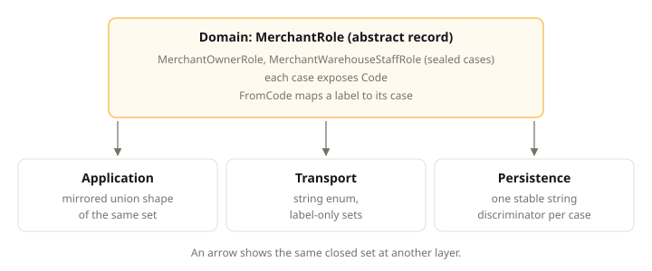

# .NET Domain Layer

## Intent

The Domain project holds the business model of a .NET backend in C# types that depend on nothing but themselves, so no outer-layer concern leaks into business rules. An aggregate is one unit of business state that stays consistent and changes in one step, and this page states the C# shape of aggregates, their lifecycles and identities, child entities, value objects, closed sets, money, repositories, events, and the exceptions that reject broken rules. The shared domain rules live on [Domain Layer](../domain.md); each rule below cites the shared rule it realizes.

## Concepts

### Aggregates and State Records

An aggregate is one unit of business state that stays consistent and changes in one step, and its root is the single type through which outside code changes it. Every aggregate exposes its lifecycle through one `State` property backed by an abstract state record with one sealed record per state. Each state record carries that state's own data, such as the publication time of a published post, and the aggregate's methods own the transitions between states.

Child entities and value objects are design choices inside an aggregate: they appear in code and the glossary, never as records.

### Closed Sets Without Enums

A closed set is a fixed group of values, such as refund outcomes or merchant roles. Domain models each one as an abstract record with one sealed case record, where each case exposes a stable string `Code` and data-less sets convert labels back through `FromCode`. An enum cannot carry case data and admits undefined values through a cast, so no enum appears in Domain.

### Identities, Money, and Repositories

Each aggregate identity is a small struct over one version 7 `Guid`, created by the caller and passed in. Money is a shared value object with a decimal amount and an ISO 4217 currency code. Each aggregate root gets one repository interface that loads and stages that aggregate only, and the command pipeline owns the commit.

## Standards

### Keep Domain Free of Outer-Layer Concerns

**Statement:** The Domain project MUST reference only the .NET base class library and project-owned Domain types.

**Rationale:** A package reference is a direction: once Domain names a persistence or web type, business rules start depending on the framework instead of the framework depending on them. Keeping Domain to the base class library and project-owned types means a provider change cannot reach business behavior. Infrastructure registers persisted discriminators and mappings, so Domain carries no serialization attribute. This provision states the .NET form of `litespec/backend/domain#keep-domain-independent-of-outer-layers`.

### Use the Project Aggregate Root Contract

**Statement:** An aggregate root MUST be a sealed class deriving from the project-owned `AggregateRoot<TId>`, taking identity and event mechanics from that base.

**Rationale:** One project-owned base gives every aggregate the same identity and event mechanics: typed identity, a pending event collection, protected recording, and clearing. The root is a sealed class, so no behavior extends an aggregate by inheritance. The root type name derives from the aggregate identifier, so the builder links the record by that name. A shared base that also owned timestamps, audit, tenancy, lifecycle, or persistence would force every aggregate to carry behavior most never need. This provision states the .NET form of `litespec/backend/domain#take-identity-and-events-from-the-project-root-contract`.

### Model Child Entities as Sealed Classes

**Statement:** A child entity MUST be a sealed class deriving from the project-owned `Entity<TId>`.

**Rationale:** The base supplies typed identity and identity equality, so the child declares its own data and behavior only. The root creates, finds, and changes its children through business methods, and a child exposes no mutable state outside the root. A child is a design choice inside its aggregate: it appears in code and the glossary, never as a record. This provision states the .NET form of `litespec/backend/domain#keep-child-entities-inside-the-aggregate-boundary`.

**Example:**

```csharp
public sealed class OrderLine : Entity<OrderLineId>
{
    internal OrderLine(OrderLineId id, ProductId product, int quantity, Money price)
        : base(id)
    {
        Product = product;
        Quantity = quantity;
        Price = price;
    }

    public ProductId Product { get; }

    public int Quantity { get; private set; }

    public Money Price { get; }

    internal void ChangeQuantity(int quantity)
    {
        Quantity = quantity;
    }
}
```

`Order.AddLine` creates the line, and `Order.ChangeLineQuantity` calls `ChangeQuantity` after checking its invariant.

### Model Value Objects as Records

**Statement:** A value object MUST be an immutable C# record with no base type.

**Rationale:** Immutability with comparison by complete value lets two instances with the same data stand in for each other. The type exposes no setter and no implicit conversion, and creation through a named static method keeps every construction path under the validation the type declares. A value object containing a collection implements content equality and a matching hash for its declared ordering rule, copying incoming collections and returning read-only views. This provision states the .NET form of `litespec/backend/domain#use-immutable-value-objects-for-domain-concepts` and `litespec/backend/domain#define-collection-value-semantics-explicitly`.

**Example:** A post title reads as follows:

```csharp
public sealed record PostTitle
{
    private PostTitle(string value)
    {
        Value = value;
    }

    public string Value { get; }

    public static PostTitle Create(string value)
    {
        if (string.IsNullOrWhiteSpace(value))
        {
            throw new PostTitleRequiredException();
        }

        if (value.Length > 200)
        {
            throw new PostTitleExceedsMaximumLengthException(value.Length);
        }

        return new PostTitle(value);
    }

    public override string ToString() => Value;
}
```

A tag collection treats order as meaningful and reads as follows:

```csharp
public sealed record PostTags
{
    private readonly IReadOnlyList<string> _values;

    private PostTags(IEnumerable<string> values)
    {
        _values = values.ToList().AsReadOnly();
    }

    public IReadOnlyList<string> Values => _values;

    public static PostTags Create(IEnumerable<string> values) => new(values);

    public bool Equals(PostTags? other) =>
        other is not null && _values.SequenceEqual(other._values);

    public override int GetHashCode()
    {
        var hash = new HashCode();

        foreach (var value in _values)
        {
            hash.Add(value, StringComparer.Ordinal);
        }

        return hash.ToHashCode();
    }
}
```

If order is not part of the value, creation normalizes to the documented comparison order before storing values.

### Implement Domain Services as Stateless Classes

**Statement:** A domain service MUST be a stateless sealed class accepting and returning Domain values.

**Rationale:** Some calculations span concepts with no natural aggregate owner, and a stateless service holds that calculation with no persistence, messaging, logging, clock, authorization, or provider call. Application loads the aggregates, calls the service, and passes its result into aggregate behavior. A service whose name cannot follow its rule carries an `/// <implements>` tag, so the builder still links it. This provision states the .NET form of `litespec/backend/domain#use-stateless-domain-services-for-ownerless-rules`.

**Example:** An order pricing service reads as follows:

```csharp
public sealed class OrderPricingDomainService
{
    public Money CalculateTotal(
        IReadOnlyList<OrderLine> lines,
        Currency currency)
    {
        return lines.Aggregate(
            Money.Zero(currency),
            (total, line) => total.Add(line.Subtotal));
    }
}
```

Application supplies the lines and passes the returned `Money` to `Order.ConfirmPrice`. The service has no repository, clock, logger, or provider client.

### Model Every Aggregate Lifecycle with State Records

**Statement:** An aggregate MUST expose its lifecycle only through one `State` property backed by an abstract `{Aggregate}State` record with sealed per-state records.

**Rationale:** An enum, status string, boolean flag, parallel nullable field, or computed state cannot carry state-specific data, and the compiler cannot prove a branch over them is exhaustive. A missed case then fails at run time instead of at build time. State records hold each state's data, aggregate methods own the transitions, and even a one-state aggregate defines its hierarchy so later states have a home. The sealed set matches the aggregate's declared `states`, which is the link the builder follows. This provision states the .NET form of `litespec/backend/domain#model-every-aggregate-lifecycle-with-state-types`.

**Example:**

```csharp
public abstract record PostState;

public sealed record PostDraftState : PostState;

public sealed record PostPublishedState(
    DateTimeOffset PublishedAt) : PostState;
```

Even an aggregate with one current state defines its hierarchy:

```csharp
public abstract record ProfileState;

public sealed record ProfileActiveState : ProfileState;
```

### Model Every Closed Set of Domain Values Without Enums

**Statement:** The Domain project MUST model every closed set as an abstract record base with sealed cases exposing one stable `Code`, converting labels through `FromCode`.

**Rationale:** An enum is a named integer: it carries no case data, admits undefined values through a cast, and forces parallel fields when a case later gains data. A closed hierarchy lets the compiler check exhaustiveness, and a boundary converts a label through `FromCode` instead of `ToString`, so an unrecognized label becomes a validation failure rather than a silent default. This provision states the .NET form of `litespec/backend/domain#model-every-closed-set-of-domain-values-as-a-closed-type-hierarchy`.

**Example:**

```csharp
public abstract record RefundOutcome
{
    public abstract string Code { get; }
}

public sealed record RefundPendingOutcome(string Reason) : RefundOutcome
{
    public override string Code => "pending";
}

public sealed record RefundSucceededOutcome(DateTimeOffset ProviderTime) : RefundOutcome
{
    public override string Code => "succeeded";
}

public sealed record RefundFailedOutcome(string Classification) : RefundOutcome
{
    public override string Code => "failed";
}

public sealed record RefundReversedOutcome(DateTimeOffset ProviderTime) : RefundOutcome
{
    public override string Code => "reversed";
}
```

A case that owns no data is still a sealed record, so the set can grow case data later without a breaking change:

```csharp
public abstract record MerchantRole
{
    public abstract string Code { get; }

    public static MerchantRole FromCode(string code) => code switch
    {
        "owner" => new MerchantOwnerRole(),
        "warehouse-staff" => new MerchantWarehouseStaffRole(),
        _ => throw new MerchantUnsupportedRoleException(code),
    };
}

public sealed record MerchantOwnerRole : MerchantRole
{
    public override string Code => "owner";
}

public sealed record MerchantWarehouseStaffRole : MerchantRole
{
    public override string Code => "warehouse-staff";
}
```

Callers branch with a `switch` expression on the case type. A `switch` that omits a case surfaces at review as a missing arm rather than a silent default. A case that carries data exposes it directly instead of through a separate nullable field:

```csharp
var next = outcome switch
{
    RefundSucceededOutcome succeeded => Settle(succeeded.ProviderTime),
    RefundPendingOutcome pending => HoldFor(pending.Reason),
    RefundFailedOutcome failed => Reclassify(failed.Classification),
    RefundReversedOutcome reversed => Reverse(reversed.ProviderTime),
    _ => throw new RefundUnsupportedOutcomeException(),
};
```

A closed set represented by one scalar uses a typed value object, never an `enum` backing field.

This provision binds the Domain project. The same set appears at three other layers, and each layer has exactly one permitted form:

| Layer | Form of a closed set | Owning provision |
|:---|:---|:---|
| Domain | Abstract record base with sealed cases. | `litespec/backend/dotnet/domain#model-every-closed-set-of-domain-values-without-enums` |
| Application | The same union shape, mirrored. | `litespec/backend/application#mirror-a-domain-closed-set-in-the-result` |
| Transport | Polymorphic `oneOf` model, or string `enum` for a label-only set. | `litespec/backend/api#mirror-a-domain-closed-set-as-a-transport-model-of-the-same-shape` |
| Persistence | One stable string discriminator for each case. | `litespec/backend/persistence#keep-serialization-behavior-out-of-domain` |

A transport `enum` is permitted in one situation: every case of the set carries no data, and the labels are the complete contract. A set where any case carries data crosses the boundary as a polymorphic model instead.

A transport `enum` never re-enters Domain. The Application layer converts the label to its record case before it calls a Domain method.

Round-trip tests cover every data-less case, which catches a renamed code and a missing label:

```csharp
[Theory]
[MemberData(nameof(AllRoles))]
public void FromCode_round_trips_every_case(MerchantRole role)
{
    Assert.Equal(role, MerchantRole.FromCode(role.Code));
}
```

The diagram shows the `MerchantRole` hierarchy with its cases, `Code`, and `FromCode`, and the same set at the three other layers the table names.



### Use Strongly Typed Version 7 Identifiers

**Statement:** An aggregate identity MUST be a `readonly record struct` wrapping one version 7 `Guid`, declaring no implicit conversion, primitive alias, or public parameterless creation path.

**Rationale:** A bare `Guid` parameter accepts any identifier, including an empty one and one meant for another aggregate. The typed struct rejects `Guid.Empty` and the struct default in every factory, implements `IStronglyTypedId` and `IParsable<TId>`, and declares no implicit conversion or parameterless creation, so a wrong identifier fails at the boundary. New values arrive from the caller: a factory takes its identifier as an argument, and a method that needs several takes a generator. Domain reads no clock and calls no static source of time or randomness, which keeps business behavior deterministic and testable. This provision states the .NET form of `litespec/backend/domain#identify-aggregates-with-strongly-typed-version-7-values`.

When two callers generate the same value, persistence rejects the duplicate key and the operation fails on the same path as any other write conflict.

**Example:**

```csharp
public readonly record struct PostId : IStronglyTypedId, IParsable<PostId>
{
    private PostId(Guid value)
    {
        Value = value;
    }

    public Guid Value { get; }

    public static PostId From(Guid value)
    {
        if (value == Guid.Empty)
        {
            throw new PostIdentityRequiredException();
        }

        return new PostId(value);
    }

    public static PostId Parse(string value, IFormatProvider? provider) =>
        From(Guid.Parse(value));

    public static bool TryParse(
        string? value,
        IFormatProvider? provider,
        out PostId result)
    {
        if (Guid.TryParse(value, out var parsed) && parsed != Guid.Empty)
        {
            result = new PostId(parsed);
            return true;
        }

        result = default;
        return false;
    }

    public override string ToString() => Value.ToString();
}
```

The `IParsable<TId>` implementation supports Minimal API route and query binding. `Parse` follows the .NET parsing contract for malformed text. `From` applies the domain empty-identity rule.

### Make Money and Decimal Rules Explicit

**Statement:** A monetary amount MUST use `decimal` inside one shared `Money` value object carrying an ISO 4217 currency code and serializing as `{ "amount": "12.50", "currency": "EUR" }`.

**Rationale:** Binary floating point cannot represent most decimal amounts exactly, so money computed in `double` drifts by cents. The shared `Money` object keeps a `decimal` amount with an ISO 4217 currency code, and the owning module record defines supported currencies, scale, rounding, sign rules, and cross-currency arithmetic. Infrastructure maps that precision explicitly, and a use case fixed to one currency accepts an amount alone while stating that currency in its record. This provision states the .NET form of `litespec/backend/domain#model-money-with-exact-decimal-values`.

**Example:**

```csharp
public sealed record Money
{
    private Money(decimal amount, string currency)
    {
        Amount = amount;
        Currency = currency;
    }

    public decimal Amount { get; }

    public string Currency { get; }

    public static Money Create(decimal amount, string currency) => new(amount, currency);

    public override string ToString() => $"{Amount} {Currency}";
}
```

```json
{ "amount": "12.50", "currency": "EUR" }
```

The amount serializes as a string, so no reader parses it as binary floating point.

### Keep Repository Interfaces in Domain

**Statement:** A repository interface MUST expose only aggregate and Domain types for exactly one aggregate root, without `IQueryable`, a session, or a generic CRUD surface.

**Rationale:** One repository per aggregate keeps the write boundary aligned with the consistency boundary: the interface loads and stages complete aggregates of its own type, and nothing else. `GetByIdAsync` throws `{Aggregate}NotFoundException` for a required load, so handlers repeat no null check; a nullable `FindBy...Async` is reserved for lookups where absence is normal. `IQueryable`, sessions, and generic CRUD surfaces would leak query shaping and provider behavior into Domain, so the interface exposes none of them. This provision states the .NET form of `litespec/backend/domain#expose-repositories-for-one-aggregate-only`.

This interface is the write side only. Reading for a Query uses a Read Model owned by Application and shaped by Infrastructure, and that path declares no Domain interface. A repository that gained a projection method would put query shapes in Domain, which is the coupling this layer exists to prevent.

**Example:**

```csharp
public interface IPostRepository
{
    Task<Post> GetByIdAsync(
        PostId id,
        CancellationToken cancellationToken);

    void Store(Post post);
}
```

`GetByIdAsync` returns a loaded `Post` and throws `PostNotFoundException` when the identity has no aggregate. The Infrastructure implementation throws that exception. The command pipeline owns the commit. `Store` stages the aggregate through the selected provider implementation.

```csharp
// Infrastructure implementation throws the aggregate's own not-found exception.
public async Task<Post> GetByIdAsync(PostId id, CancellationToken cancellationToken)
{
    var post = await session.LoadAsync<Post>(id, cancellationToken);
    return post ?? throw new PostNotFoundException();
}
```

### Raise Immutable Domain Facts

**Statement:** A domain event MUST be a public immutable record named `{Aggregate}{PastFact}Event` implementing `IDomainEvent` and carrying business data only.

**Rationale:** The `{Aggregate}{PastFact}Event` name tells a reader which aggregate raised the fact without opening the file. The event carries business data only: typed identifiers and the values its reactions need. It carries no aggregate, session, service, mutable collection, or exception, because a mutable payload lets a reaction observe state that changed after the fact. Envelope identity, such as message and causation identity, lives on the published integration event that carries the fact outside the process. The event type name derives from the event identifier: `AccessCodeIssuedEvent` is `event/access-code.issued`. An event whose name cannot follow its identifier states the identifier as a string literal in its type, which the builder links instead. Only the aggregate root raises events, through `RaiseDomainEvent` on the shared base. This provision states the .NET form of `litespec/backend/domain#raise-immutable-facts-as-domain-events`.

### Reject Business Violations with Domain Exceptions

**Statement:** A rejected business rule MUST throw a `DomainException` subclass named `{DomainType}{Reason}Exception` carrying the refusal `code`.

**Rationale:** One exception type per rule puts the stable code and the message in the type, so the call site passes only domain values and two rules never share a type by accident. A shared rule exception with caller-supplied codes lets any caller invent a code and lets unrelated rules merge silently. An invariant rule is checked in the root's factory and methods, and a precondition rule is checked in the use-case validator or the root's method. Each exception's code equals the refusal `code` on the result record it answers. Names lead with the aggregate root and follow `litespec/workspace/naming#name-exceptions-by-failed-rule`; this provision owns the one-type-per-rule shape and the code each type carries. Domain throws no `InvalidOperationException`, `ArgumentException`, validation, HTTP, or provider exception for a business rejection, and carries no transport status. This provision states the .NET form of `litespec/backend/domain#reject-business-violations-with-dedicated-refusals`.

**Example:**

```csharp
// Prohibited: the aggregate carries the code and message, and one type covers unrelated rules.
if (allocation.Count == 0)
{
    throw new RefundRuleException("refunds.allocation-invalid", "A refund requires at least one allocation line.");
}

if (allocation.Any(line => line.Quantity <= 0))
{
    throw new RefundRuleException("refunds.allocation-invalid", "Each allocation quantity must be positive.");
}

// Required: one type per rule; the type owns the code and message; the call site passes only domain values.
if (allocation.Count == 0)
{
    throw new RefundAllocationRequiredException();
}

if (allocation.Any(line => line.Quantity <= 0))
{
    throw new RefundAllocationQuantityInvalidException();
}
```

```csharp
public sealed class RefundAllocationRequiredException()
    : DomainException("A refund requires at least one allocation line.")
{
    public override string Code => "refunds.allocation-required";
}
```

Two rules that share a caller-visible refusal code because a boundary maps them to one response still get two exception types. The shared code lives in the two types, not in a string passed by the aggregate. Reuse a single exception type only when one rule can fail from more than one input and the differing values are carried as constructor parameters.

Application validators handle malformed caller input through validation errors. Aggregate and value-object exceptions remain the final check when direct Domain use violates a rule. Command handlers do not catch expected Domain exceptions. The host maps them through the documented error boundary.

### Document Every Public Domain Contract

**Statement:** Every public Domain type and member MUST carry XML documentation stating the business constraint, result, or failure it represents.

**Rationale:** A public Domain member is a business promise, and its XML documentation is where a reader learns the constraint, result, or failure it represents. A summary that restates the member name adds nothing; a mutation method names its source states, resulting state, protected invariant, and recorded event. Without that, callers infer the contract from the implementation and miss the rule. This provision states the .NET form of `litespec/backend/domain#describe-every-public-domain-contract-in-documentation`.

## Conventions

*Read each code block in the Conventions section as the named design rule only, without its namespace and unrelated declarations.*

### Define the Shared Domain Contracts Once

**Default:** Declare the shared Domain contracts once in the Domain project and reuse them across every module.

**Replacement:** A project names its shared contract home in its Domain documentation.

**Rationale:** Every module raises events, throws domain exceptions, and identifies aggregates, so each shared contract declared twice becomes two contracts that drift. Declaring `IDomainEvent`, `DomainException`, `IStronglyTypedId`, `Entity<TId>`, `IAggregateRoot`, and `AggregateRoot<TId>` once in the Domain project gives every module the same mechanics. Generic handling constrains its parameters with `IAggregateRoot`, as in `IRepository<T> where T : IAggregateRoot`. This provision states the .NET form of `litespec/backend/domain#reuse-the-shared-domain-contracts-across-modules`.

**Example:**

```csharp
public interface IDomainEvent;

public abstract class DomainException(string message) : Exception(message)
{
    public abstract string Code { get; }
}

public interface IStronglyTypedId
{
    Guid Value { get; }
}

public abstract class Entity<TId>
    where TId : struct, IStronglyTypedId
{
    protected Entity(TId id)
    {
        Id = id;
    }

    public TId Id { get; }

    public override bool Equals(object? obj) =>
        obj is Entity<TId> other
        && GetType() == other.GetType()
        && Id.Equals(other.Id);

    public override int GetHashCode() =>
        HashCode.Combine(GetType(), Id);
}

public interface IAggregateRoot
{
    IReadOnlyList<IDomainEvent> DomainEvents { get; }

    void ClearDomainEvents();
}

public abstract class AggregateRoot<TId> : Entity<TId>, IAggregateRoot
    where TId : struct, IStronglyTypedId
{
    private readonly List<IDomainEvent> _domainEvents = [];

    protected AggregateRoot(TId id)
        : base(id)
    {
    }

    public IReadOnlyList<IDomainEvent> DomainEvents =>
        _domainEvents.AsReadOnly();

    protected void RaiseDomainEvent(IDomainEvent domainEvent)
    {
        _domainEvents.Add(domainEvent);
    }

    public void ClearDomainEvents()
    {
        _domainEvents.Clear();
    }
}
```

`ClearDomainEvents` is event-delivery mechanics, not a business mutation entry point. Infrastructure calls it only after the selected delivery path has accepted the pending events.

Concrete aggregates validate that `id.Value` is not `Guid.Empty` before or while calling the base constructor. The base remains free of aggregate-specific exceptions.

### Keep ID Representations Aligned at Every Boundary

**Default:** Represent an identifier the same way in Domain, persistence, transport, and generated clients.

**Replacement:** A project names its identifier representations in its Domain documentation.

**Rationale:** An identifier crosses every boundary in the table below, and each boundary that invents its own text form forces converters at both ends. One UUID text form everywhere means a value copied from a log, a route, or a JSON payload parses at the next boundary without translation. This provision states the .NET form of `litespec/backend/domain#align-id-representations-at-every-boundary`.

**Example:**

| Boundary | Representation | Owner |
|:---|:---|:---|
| Creation | Caller-supplied value or generator through arguments. | Caller |
| Domain and Application | `PostId` | Domain |
| Minimal API route and query | UUID text parsed through `IParsable<PostId>` | WebApi |
| JSON | UUID string | WebApi converter |
| OpenAPI | `type: string`, `format: uuid` | WebApi schema transformer |
| Marten | Native UUID identity plus explicit typed-ID mapping | Infrastructure |
| EF Core extension | Explicit value converter to UUID | Infrastructure |
| Generated TypeScript | `string` from OpenAPI | Generated client |

For multiple IDs, WebApi uses one converter factory restricted to `IStronglyTypedId` implementations. The OpenAPI transformer applies the same restriction. The factory does not convert every `IParsable<T>` type into a UUID schema.

```csharp
if (typeof(IStronglyTypedId).IsAssignableFrom(context.JsonTypeInfo.Type))
{
    schema.Type = JsonSchemaType.String;
    schema.Format = "uuid";
    schema.Properties?.Clear();
}
```

### Use the Domain Module Layout

**Default:** Give each aggregate a folder named with its plural root name, holding its states, events, exceptions, and concepts in the files this provision names.

**Replacement:** A project names its Domain module layout in its Domain documentation.

**Rationale:** Each aggregate folder holds everything one aggregate owns in the files the layout names, so a reader finds the full aggregate in one place. Namespaces follow the folders under `litespec/workspace/naming#keep-namespaces-aligned-with-folders`, and each file sits at the lowest folder holding its consumers under `litespec/backend/architecture#place-a-type-at-the-lowest-folder-that-holds-its-consumers`. This provision states the .NET form of `litespec/backend/domain#organize-a-module-by-aggregate-and-concept`.

**Example:** The Domain module layout is:

```text
{ProjectName}.Domain/
  Shared/
    AggregateRoot.cs
    Entity.cs
    IAggregateRoot.cs
    IDomainEvent.cs
    StronglyTypedIds/
      IStronglyTypedId.cs
    Exceptions/
      DomainException.cs
  Posts/                          one aggregate whose name matches the module: kept flat in the module folder
    Post.cs
    PostId.cs
    PostTitle.cs
    IPostRepository.cs
    States/
      PostState.cs
      PostDraftState.cs
      PostPublishedState.cs
      PostArchivedState.cs
    Events/
      PostCreatedEvent.cs
      PostPublishedEvent.cs
    Exceptions/
      PostIdentityRequiredException.cs
      PostAlreadyPublishedException.cs
  Shipping/                       one aggregate whose name differs from the module, with a domain union in a concept folder
    Shipments/
      Shipment.cs
      ShipmentId.cs
      IShipmentRepository.cs
      Outcomes/
        ShipmentOutcome.cs
        ShipmentDeliveredOutcome.cs
        ShipmentReturnedOutcome.cs
        ShipmentLostOutcome.cs
      States/
        ShipmentState.cs
        ShipmentPendingState.cs
        ShipmentDispatchedState.cs
        ShipmentDeliveredState.cs
      Events/
        ShipmentOutcomeRecordedEvent.cs
  Customers/                      more than one aggregate: one plural folder per aggregate
    CustomerAccounts/               namespace Shop.Domain.Customers.CustomerAccounts
      CustomerAccount.cs
      CustomerAccountId.cs
      ICustomerAccountRepository.cs
      States/
        CustomerAccountState.cs
        CustomerAccountClaimedState.cs
      Events/
        CustomerAccountRestrictedEvent.cs
    Consents/                       namespace Shop.Domain.Customers.Consents
      Consent.cs
      ConsentId.cs
      IConsentRepository.cs
      States/
        ConsentState.cs
        ConsentGrantedState.cs
      Events/
        ConsentGrantedEvent.cs
```

Each aggregate-specific repository interface stays with the aggregate it loads. Application, Infrastructure, and WebApi use the same module and per-aggregate folder names, per `litespec/backend/architecture#organize-every-layer-by-module-and-use-case`.

## Reference Example

This informative example demonstrates `litespec/backend/dotnet/domain#use-the-project-aggregate-root-contract`, `litespec/backend/dotnet/domain#model-every-aggregate-lifecycle-with-state-records`, and `litespec/backend/domain#create-valid-aggregates-through-named-factories`.

```csharp
public sealed class Post : AggregateRoot<PostId>
{
    private Post(
        PostId id,
        AuthorId authorId,
        PostTitle title,
        PostState state)
        : base(RequireIdentity(id))
    {
        if (authorId == default)
        {
            throw new AuthorIdentityRequiredException();
        }

        AuthorId = authorId;
        Title = title;
        State = state;
    }

    private static PostId RequireIdentity(PostId id)
    {
        if (id == default)
        {
            throw new PostIdentityRequiredException();
        }

        return id;
    }

    public AuthorId AuthorId { get; }

    public PostTitle Title { get; private set; }

    public PostState State { get; private set; }

    public static Post CreateDraft(
        PostId id,
        AuthorId authorId,
        PostTitle title,
        DateTimeOffset createdAt)
    {
        var post = new Post(
            id,
            authorId,
            title,
            new PostDraftState());

        post.RaiseDomainEvent(
            new PostCreatedEvent(id, authorId, title, createdAt));

        return post;
    }

    public void ChangeTitle(PostTitle title)
    {
        if (State is not PostDraftState)
        {
            throw new PostCannotBeEditedException(Id, State);
        }

        Title = title;
    }

    public void Publish(DateTimeOffset publishedAt)
    {
        switch (State)
        {
            case PostDraftState:
                State = new PostPublishedState(publishedAt);
                RaiseDomainEvent(
                    new PostPublishedEvent(Id, AuthorId, Title, publishedAt));
                break;

            case PostPublishedState:
                throw new PostAlreadyPublishedException(Id);

            case PostArchivedState:
                throw new PostCannotPublishArchivedException(Id);

            default:
                throw new PostUnsupportedStateException(Id, State);
        }
    }
}

public sealed record PostCreatedEvent(
    PostId PostId,
    AuthorId AuthorId,
    PostTitle Title,
    DateTimeOffset CreatedAt) : IDomainEvent;

public sealed record PostPublishedEvent(
    PostId PostId,
    AuthorId AuthorId,
    PostTitle Title,
    DateTimeOffset PublishedAt) : IDomainEvent;
```

The event payload captures the publication fact without carrying the mutable `Post`. An event reaction implementation uses values from the transition or loads a current read model when it needs current data.

## Verification

| ID | Mark | Evidence |
|:---|:---|:---|
| litespec/backend/dotnet/domain#keep-domain-free-of-outer-layer-concerns | guidance | The Domain project references: only the .NET base class library and project-owned Domain types. |
| litespec/backend/dotnet/domain#use-the-project-aggregate-root-contract | guidance | Each aggregate root declaration: a sealed class deriving from the project-owned `AggregateRoot<TId>`. |
| litespec/backend/dotnet/domain#model-child-entities-as-sealed-classes | guidance | Each child entity declaration in the Domain project: a sealed class deriving from `Entity<TId>`, created through root methods. |
| litespec/backend/dotnet/domain#model-value-objects-as-records | guidance | Each value object in the Domain project: an immutable record with static creation and no base type. |
| litespec/backend/dotnet/domain#implement-domain-services-as-stateless-classes | guidance | Each domain service in the Domain project: a stateless sealed class with Domain-only parameters and no provider calls. |
| litespec/backend/dotnet/domain#model-every-aggregate-lifecycle-with-state-records | guidance | Each aggregate: one `State` property over an abstract state record with one sealed record per state. |
| litespec/backend/dotnet/domain#model-every-closed-set-of-domain-values-without-enums | guidance | Each closed set in the Domain project: an abstract record with sealed cases exposing `Code`, `FromCode` on data-less sets, and no `enum`. |
| litespec/backend/dotnet/domain#use-strongly-typed-version-7-identifiers | guidance | Each aggregate identity: a `readonly record struct` over one version 7 `Guid`, with no conversion, alias, or parameterless creation. |
| litespec/backend/dotnet/domain#make-money-and-decimal-rules-explicit | guidance | Each monetary amount: a `decimal` inside the shared `Money` object, serialized with amount and currency. |
| litespec/backend/dotnet/domain#keep-repository-interfaces-in-domain | guidance | Each repository interface: Domain-only types for one aggregate root, with no `IQueryable`, session, or generic surface. |
| litespec/backend/dotnet/domain#raise-immutable-domain-facts | guidance | Each domain event: an immutable record named `{Aggregate}{PastFact}Event`, carrying business data only. |
| litespec/backend/dotnet/domain#reject-business-violations-with-domain-exceptions | guidance | Each rejected business rule: its own `DomainException` type carrying the refusal `code`, with no transport status. |
| litespec/backend/dotnet/domain#document-every-public-domain-contract | checkable | `dotnet build` of the Domain project reports no LiteSpec.Analyzers LS1011 diagnostic. |
| litespec/backend/dotnet/domain#define-the-shared-domain-contracts-once | guidance | The shared Domain contracts: each declared once, with `DomainException` declaring its abstract `Code` and `AggregateRoot<TId>` deriving from `Entity<TId>`. |
| litespec/backend/dotnet/domain#keep-id-representations-aligned-at-every-boundary | guidance | Each identifier at Domain, persistence, transport, and client boundaries: the same UUID text form. |
| litespec/backend/dotnet/domain#use-the-domain-module-layout | guidance | Each Domain module folder: one plural folder per aggregate holding its states, events, exceptions, and concepts. |
