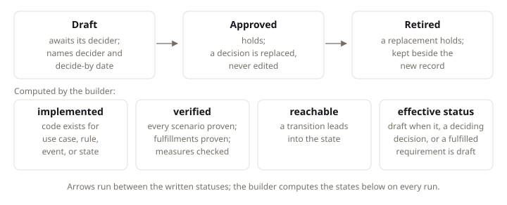

# Project Model

## Intent

A LiteSpec project describes itself with records, written statements of fixed types joined by fixed links. People and agents write the intent, and the model builder reads code, screens, tests, and test runs to compute how the two connect. This page states the record types, where each one lives, which links join them, and the authority order that settles conflicts. The result is one map from approved intent to running code that every agent shares.

## Concepts

### Record types

Each type answers one question. Small projects keep the rows marked small. Large projects also keep the rows marked large. Optional rows switch on for each project.

| Type | Kept | Question |
|:---|:---|:---|
| `product` | small | What is built, for whom, and what is excluded? |
| `constraint` | optional, answered always | Which outside rules hold? |
| `research` | optional | Which outside facts inform a choice? |
| `decision` | small | Which choice holds, and what changes it? |
| `requirement` | small | What does the product do or guarantee? |
| `problem` | large | Which pain does someone have today? |
| `feature` | large | What is offered against a problem? |
| `actor` | small | Who or what touches the product? |
| `role` | small | Which permission sets exist? |
| `permission` | small | Which single actions are allowed? |
| `journey` | large | Which ordered steps reach one goal? |
| `module` | small | Which business areas exist? |
| `business-record` | small | Which things stay consistent? |
| `rule` | small | What holds? |
| `use-case` | small | Which operations exist? |
| `result` | small | How does a use case end? |
| `case` | large | Which example proves the result? |
| `event` | small | What happened? |
| `entry-point` | small | How do people reach the product? |
| `limit` | optional, required from first production | Which bounds hold in production? |
| `runbook` | optional, required from first production | How is it run or recovered? |
| `standard` | small | How is it built? |
| `exception` | small | Where does it depart, and until when? |
| `known-gap` | small | What is missing, who owns it, and until when? |
| `term` | small | Which word means what? |

The record types group by the question each answers, from intent through operation to project records.


### Pages and entries

A page record is a Markdown file whose opening block names a record type. An entry record is an object in the `records` array of that block. Terms are the exception: each term is an entry in the language record. Each type has one home.

| Type | Stored as | Home |
|:---|:---|:---|
| `product` | page, exactly one | `docs/product/brief.md` |
| `constraint` | page | `docs/product/constraints/<name>.md` |
| `research` | page | `docs/research/<name>.md` |
| `decision` | page | `docs/product/decisions/<number>-<name>.md` |
| `requirement` | entry | `docs/product/<area>/<topic>.md` |
| `problem` | page | `docs/product/problems/<name>.md` |
| `feature` | page | `docs/product/features/<name>.md` |
| `actor` | page | `docs/domain/actors/<name>.md` |
| `role` | page | `docs/domain/roles/<name>.md` |
| `permission` | entry | `docs/domain/permissions.md` |
| `journey` | page | `docs/product/journeys/<name>.md` |
| `module` | page | `docs/domain/modules/<module>/README.md` |
| `business-record` | page | `docs/domain/modules/<module>/<records>/README.md` |
| `rule` | entry | `docs/domain/rules/<name>.md` |
| `use-case` | page | `docs/domain/modules/<module>/<records>/<use-case>.md` |
| `result` | entry | In its use case page |
| `case` | entry | In its use case page |
| `event` | entry | On its business record page |
| `entry-point` | entry | `docs/domain/entry-points.md` |
| `limit` | entry | `docs/operations/limits.md` |
| `runbook` | page | `docs/runbooks/<name>.md` |
| `standard` | shared provisions, or entries on rule pages | `docs/domain/rules/<name>.md` |
| `exception` | page | `docs/exceptions/<name>.md` |
| `known-gap` | page | `docs/known-gaps/<name>.md` |
| `term` | entry in the language record | `docs/language.json` |

### Common fields

Every written record carries the shared fields in this table. Entries inherit `owner` and `status` from their page unless they set their own.

| Field | Written | Meaning |
|:---|:---|:---|
| `type` | always | The record type in kebab case |
| `id` | always | The identifier |
| `title` | always | The display title, free to change |
| `owner` | pages; entries inherit | One name from the closed owner list |
| `status` | pages; entries inherit | Draft, approved, or retired |
| `decider` | on drafts | The owner deciding by the date |
| `decideBy` | on drafts | The decision date in ISO form |
| `replaces` | decision, when replacing | The decision this decision replaces |
| `terms` | when used | The term identifiers the record uses |

### Links

Each written link lives as a field on the record the link starts from: a decision carries `decides`, a rule carries `fulfills`, and so on. The table names every written link field, the record that carries it, and what it points at.

| Field | Written on | Points at |
|:---|:---|:---|
| `decides` | decision | Requirements, features, rules, constraints, and the permissions, roles, actors, exceptions, standards, entry points, limits, or decisions an engineering choice settles |
| `basedOn` | decision, requirement, rule | Constraints, research |
| `affects` | problem | Actors |
| `solves` | feature | Problems |
| `fulfills` | rule, use case, journey | Requirements |
| `governs` | rule | Business records, use cases |
| `results` | use case | Its result entries |
| `cases` | use case | Its case entries; each names its result |
| `raises` | use case | Events |
| `reactsTo` | use case | Events it reacts to |
| `holds` | actor | Roles at a scope |
| `allows` | role | Permissions |
| `needs` | use case | Permissions |
| `reachedThrough` | use case | Entry points |
| `steps` | journey | Ordered use cases with actors |
| `dependsOn` | module | Modules |
| `terms` | any record | Terms |
| `replaces` | decision | The replaced decision |

Containment needs no link field: it follows the identifier. A business record belongs to the module its identifier names, and a result belongs to the use case its identifier names. The builder computes the remaining links from code, routes, and tests: `implements` from code to a use case, rule, or event; `calls` from a screen to a use case; and `proves` from a test to a case.

### Authority

Intent flows down one order: constraint, product, requirement, rule, and use case. When two records disagree, the higher one wins. A decision explains a choice and is replaced, never edited. Research, examples, and prose carry no authority, so they never override an approved record.

Truth about today comes from code, screens, and test runs. When intent and truth mismatch, the owner of the higher record owns the defect: a failing test does not settle what the product should do.

A record stays unapproved while a decision behind it stays draft. An accepted gap becomes a known gap, and its check reports without failing until the end date. Access flows from actor to role to permission to use case. Module order states dependencies and grants no authority.

### Statuses

Draft means the record awaits its decider, approved means it holds, and retired means a replacement holds. A draft names its `decider` and its `decideBy` date.

Implemented and verified are computed, never handwritten: code grants the first when the handler exists, and passing proof grants the second when every case passes.

### Size and stacks

Small projects keep the small rows from the record table, while large projects also keep the large rows. Optional types switch on for each project; limits and runbooks join at first production.

Each frontend declares one stack, and the backend declares its own. Every project answers whether constraints apply, possibly with none. Owners form a closed list, and extensions name their replacements and switched-on types. The [scope page](scope.md) states how a project selects its size, shape, and stacks.

### The model builder

The model builder reads records, code, routes, tests, and test runs into one model. It writes the model file, runs the model checks, and renders generated regions. The [model command page](../tools/model.md) lists the subcommands and finding codes.

Generated regions sit inside fences that only the builder writes and prose checks skip. Each project runs the builder in its own gate, so handwritten prose and computed views stay in one page without mixing.

## Standards

### Write every record in its home

**Requirement:** A project MUST keep every record in the home its type names.

**Rationale:** One home per type tells a reader where to open a record and tells the builder where to read it. A record kept anywhere else is invisible to the checks that scan its home, so it looks sound while nothing validates it.

**Example:** A decision lives at `docs/product/decisions/0001-receipt-threshold.md`.

### State the common fields on every record

**Requirement:** Every written record MUST carry its type, identifier, title, owner, and status.

**Rationale:** Type, identifier, title, owner, and status are the fields every join needs. Without them on every record, the builder cannot connect decisions to requirements, cases to results, or records to owners, and the model falls apart into loose pages.

### Write links on the record that points

**Requirement:** A link MUST live as fields on the record it starts from.

**Rationale:** One writing site keeps a link and its source in one edit: changing the source updates the link in the same change. Links written on the target instead would scatter each relationship across every page it touches.

### Follow the authority order

**Requirement:** A conflict MUST resolve toward the higher authority.

**Rationale:** Intent records disagree in real projects: a use case asks for behavior its rule forbids. The order settles the conflict without a meeting, with constraint over product, product over requirement, requirement over rule, and rule over use case. Decisions explain choices and research informs them, but neither outranks the ladder, so prose never silently overrides an approved record.

### Resolve ties by the later decision

**Requirement:** A tie MUST resolve toward the later approved decision.

**Rationale:** Two records at one level can disagree with no higher record to settle them. The later approved decision wins because it decided with knowledge of the earlier one. When no later decision separates them, their shared owner decides, so every tie still has exactly one judge.

### Hold approval behind draft decisions

**Requirement:** A record MUST NOT stand approved behind a draft decision.

**Rationale:** Approval means the reasoning behind the record already holds. A record approved behind a draft decision claims settled intent while its foundation can still move. The builder also writes each record's `effectiveStatus`: draft when the record, a decision deciding it, or a requirement it fulfills is a draft. A result or a case takes its use case's effective status.

### Record accepted gaps as known gaps

**Requirement:** An accepted gap MUST live as a known gap with owner and end date.

**Rationale:** Missing work with no owner and no date is invisible: nobody answers for it and nothing reports it. A known gap with an owner and an end date turns the same missing work into a visible promise that the checks report until the date and fail after it.

**Example:** The running Expenses example accepts that exporting expenses has no handler yet, so the gap lives as a known gap with an owner and an end date in `docs/known-gaps/export-expenses-unimplemented.md`.

```json
{
  "type": "known-gap",
  "id": "known-gap/export-expenses-unimplemented",
  "title": "Export expenses unimplemented",
  "owner": "expenses-team",
  "status": "approved",
  "check": "use-case-unimplemented",
  "subject": ["use-case/spending.export-expenses"],
  "endsBy": "2027-06-01",
  "reason": "Export waits for the finance file format."
}
```

The `use-case-unimplemented` check reports without failing until 2027-06-01, and the expenses team answers for closing the gap, which satisfies this provision.

### Apply guidance precedence

**Requirement:** A conflict MUST resolve toward the project exception, the extension, the deeper page, or the shallower page, in that order.

**Rationale:** A project requirement can never quietly override a shared standard; without this order it would, one page at a time. The conflict becomes an exception record instead: dated, reasoned, and reviewable. The order puts the project exception first, then the extension, then the deeper page, then the shallower page, so the most local approved decision wins.

**Example:** The running Expenses example needs its weekend export to skip the daily export review, so it records a project exception that outranks the shared standard in `docs/exceptions/export-review-bypass.md`.

```json
{
  "type": "exception",
  "id": "exception/export-review-bypass",
  "title": "Export review bypass",
  "owner": "expenses-team",
  "status": "approved",
  "standard": "standard/spending.daily-export-review",
  "reason": "The weekend export runs with no reviewer on shift.",
  "reviewBy": "2027-01-01",
  "removeWhen": "A reviewer covers weekends."
}
```

The record names the standard it departs from, the reason, and the review date, so the departure stays visible and dated, which satisfies this provision.

### Authorize access through the permission chain

**Requirement:** A use case MUST name the permissions it needs.

**Rationale:** Access decisions need one auditable path from actor to role to permission to use case. A use case that names no permission breaks the end of that chain, and nobody can answer who may run it. Entry points may then offer fewer permissions, never more.

**Example:** An anonymous use case sets `anonymous` and names no permission.

### Express module order as depends on

**Requirement:** Module order MUST live as `dependsOn` links between modules.

**Rationale:** Modules depend on each other, and each dependency needs writing down. A ranked list would imply that one module outranks another, which no authority order supports. `dependsOn` links state each dependency without ranking.

### Keep one owner and status on every record

**Requirement:** Every page MUST name one owner and one status.

**Rationale:** One owner means one person answers for the page. One status means the page either awaits decision, holds, or stands replaced. Entries inherit both from their page, so a page of entries stays consistent without repeating the fields on every object.

**Example:** A draft names its `decider` and `decideBy` date.

The three statuses and what each allows: a draft awaits its decider, approved holds, and retired means a replacement holds.



### Retire records with replaces

**Requirement:** A replacing decision MUST name the decision it replaces, and no other record type carries `replaces`.

**Rationale:** Only decisions keep the past: the retired decision stands beside its replacement so the reasoning stays readable. Every other record changes in place, because retired copies of rules or use cases would fork the intent readers must follow. A rename rewrites every citation in the same change, so no dangling reference survives.

### Name what every decision decides

**Requirement:** Every decision that is not retired MUST name at least one record it settles in `decides`.

**Rationale:** The draft gate and the computed effective status both follow `decides`. A decision that names nothing holds back nothing, so its approval state constrains no record and its draft gate checks nothing. Naming at least one settled record gives the decision something to govern.

### Resolve every page link

**Requirement:** Every Markdown link outside code on a page under the record roots MUST point at an existing file, by its relative path.

**Rationale:** A link that points at a moved file or a bare identifier reads as navigation and leads nowhere. Requiring every link to name an existing file by its relative path keeps the documentation clickable at every commit. Identifiers are cited in backticks instead, so the two never confuse.

### Declare size stacks and optional types

**Requirement:** A project MUST declare its size, stacks, and optional types.

**Rationale:** Size decides which record types and test projects the checks require, while stacks decide which technology pages and checks apply. Without the declaration, the builder cannot tell a missing record from one the project never needed. Optional types switch on per project, so the declaration also names which ones this project carries.

**Example:** The running Expenses example declares large with a server shape and two stacks.

### Give every use case its results

**Requirement:** A use case MUST end in a success result and name its refusals.

**Rationale:** Callers branch on named endings: success or a specific refusal with its code. A use case with no named success leaves callers guessing what good looks like, and cases prove one ending each, so unnamed endings stay unproven.

**Example:** A submit use case names `submitted` and `receipt-missing`.

The running Expenses example carries this in `use-case/spending.submit-expense`, which names `result/submit-expense.submitted` and `result/submit-expense.receipt-missing` in `results` and `case/submit-expense.submitting-with-a-receipt-succeeds` in `cases`:

```json
"records": [
  {
    "type": "result",
    "id": "result/submit-expense.submitted",
    "title": "Submitted",
    "owner": "expenses-team",
    "outcome": "success",
    "httpStatus": 201,
    "meaning": "The expense is submitted."
  },
  {
    "type": "result",
    "id": "result/submit-expense.receipt-missing",
    "title": "Receipt missing",
    "owner": "expenses-team",
    "outcome": "refusal",
    "code": "failure/spending.receipt_missing",
    "httpStatus": 422,
    "meaning": "The expense is above the receipt threshold and carries no receipt."
  },
  {
    "type": "case",
    "id": "case/submit-expense.submitting-with-a-receipt-succeeds",
    "title": "Submitting with a receipt succeeds",
    "owner": "expenses-team",
    "status": "approved",
    "situation": "An employee paid for a train ticket and kept the receipt.",
    "action": "The employee submits the expense with the receipt.",
    "result": "result/submit-expense.submitted",
    "expect": "The expense is submitted."
  }
]
```

Success ends with 201, the refusal carries the failure code `failure/spending.receipt_missing` with 422, and the case pairs one situation with the success result, which satisfies this provision.

### Cover every public use case from a journey

**Requirement:** A public use case MUST sit in a journey or name its background caller.

**Rationale:** A public operation that no journey reaches and no background caller names is either unreachable or wired up by accident. Reachability shows readers how each operation is found and gives every public use case a path from a user goal or a named caller.

### Read truth from code screens and test runs

**Requirement:** Implemented and verified MUST come from the builder, never from handwriting.

**Rationale:** Handwritten status drifts: a record marked implemented stays marked after its handler is deleted. Computed status cannot drift, because the builder re-derives it from handlers, routes, scenarios, and test runs on every run. A use case reads implemented when its handler exists and verified when every case passes its proof.

**Example:** A use case reads implemented when its handler exists.

## Conventions

### Render generated regions from the model

**Default:** Generated regions on a page come from the model builder.

**Replacement:** A project with no builder run records its own generation step.

**Rationale:** Fenced regions keep handwritten prose and computed views in one page without mixing them: authors edit outside the fences and the builder writes inside. A project with no builder run records its own generation step, so the regions still have exactly one writer.

## Verification

| ID | Mark | Evidence |
|:---|:---|:---|
| litespec/core/model#write-every-record-in-its-home | checkable | `litespec model check` reports `record-shape`. |
| litespec/core/model#state-the-common-fields-on-every-record | checkable | `litespec model check` reports `record-shape`. |
| litespec/core/model#write-links-on-the-record-that-points | checkable | `litespec model check` reports `reference-unresolved`. |
| litespec/core/model#follow-the-authority-order | guidance | Does each conflict resolve toward the higher authority? |
| litespec/core/model#resolve-ties-by-the-later-decision | guidance | Does the later approved decision settle each tie? |
| litespec/core/model#hold-approval-behind-draft-decisions | checkable | `litespec model check` reports `draft-gate`. |
| litespec/core/model#record-accepted-gaps-as-known-gaps | checkable | `litespec model check` reports `record-shape` and `known-gap-expired`. |
| litespec/core/model#apply-guidance-precedence | guidance | Does intent override a standard anywhere without an exception? |
| litespec/core/model#authorize-access-through-the-permission-chain | checkable | `litespec model check` reports `record-shape` and `reference-unresolved`. |
| litespec/core/model#express-module-order-as-depends-on | guidance | Does any record rank modules instead of linking them? |
| litespec/core/model#keep-one-owner-and-status-on-every-record | checkable | `litespec model check` reports `owner-unknown` and `draft-without-decider`. |
| litespec/core/model#retire-records-with-replaces | checkable | `litespec model check` reports `invalid-field` for `replaces` outside a decision and `reference-unresolved` for an unknown target. |
| litespec/core/model#name-what-every-decision-decides | checkable | `litespec model check` reports `decision-decides-nothing`. |
| litespec/core/model#resolve-every-page-link | checkable | `litespec model check` reports `link-unresolved`. |
| litespec/core/model#declare-size-stacks-and-optional-types | checkable | `litespec model check` reports `size-type-missing` and `record-shape`. |
| litespec/core/model#give-every-use-case-its-results | checkable | `litespec model check` reports `use-case-without-success` and `case-result-unresolved`. |
| litespec/core/model#cover-every-public-use-case-from-a-journey | checkable | `litespec model check` reports `journey-reach`. |
| litespec/core/model#read-truth-from-code-screens-and-test-runs | checkable | `litespec model check` reports `use-case-unimplemented`, `proves-unconfirmed`, and `refusal-not-thrown`. |
| litespec/core/model#render-generated-regions-from-the-model | guidance | Are generated regions current, or is a replacement recorded? |
