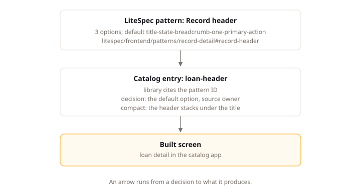

# UI Patterns

## Intent

One pattern catalog decides each recurring interface question once, such as how an order page lays out or what an empty list shows, instead of letting each screen invent its own answer. This page states what each catalog entry holds: the options considered, the option chosen and who chose it, the narrow-screen behavior, and the implementation status per platform. Product owners and frontend teams use it when they choose and build interface behavior, so every screen answers the same question the same way instead of each route inventing its own answer.

## Concepts

### Pattern Kinds

A pattern answers one recurring question. Its kind states what the question is about.

| Kind | The question it answers | Example |
|:---|:---|:---|
| `page-frame` | How is a page of this kind laid out? | A customer list page |
| `element` | How does one control behave? | Sorting on an invoice table |
| `scenario` | What shows in this situation? | An order list with no orders |

### The Catalog Entry

The catalog is one file valid against `schemas/ui-pattern-catalog.schema.json`. Each pattern entry carries these fields.

| Field | What it holds |
|:---|:---|
| `id` | The slug other records cite |
| `group` | The group the pattern belongs to |
| `title` | The pattern name |
| `question` | The recurring question the pattern answers |
| `options` | At least two options, each with rationale and cost |
| `decision` | The chosen option, its source, an optional note, and an optional record |
| `compact` | The breakpoint and the behavior below it |
| `extensions` | Further options a reader may switch to |
| `implementations` | The status and source paths per platform |
| `library` | The LiteSpec pattern ID the entry starts from, if any |

The `breakpoints` map names viewport widths, and `groups` collect related patterns. The optional `registry` field names the command or path rendering every product-added option for review.

### Pattern Pages

A pattern page holds one group of patterns, such as the record-detail group in `docs/frontend/patterns/record-detail.md`. The patterns folder names no stack, so its pages apply to every frontend under `docs/frontend/`. Each `###` heading under `## Patterns` names one pattern, and its ID is `litespec/frontend/patterns/<group>#<pattern-slug>`. The heading is a name rather than an action, so the ID survives a change of default.

A pattern carries four labeled fields, then its options.

| Field | What it holds |
|:---|:---|
| `**Question:**` | The recurring question and its situation |
| `**Default:**` | The option ID a project builds unless its catalog records another |
| `**Compact:**` | How the default behaves on a narrow screen |
| `**Rationale:**` | Why the default, the runner-up and when to prefer it, and what to leave out |

Each option is a `####` heading of the form ``#### `option-id`: Option name``. It carries one `wireframe` block, an optional `wireframe compact` block for a different phone layout, then `**Rationale:**`, `**Cost:**` and an optional `**Reference:**`. An option ID is stable once published. The page's Standards hold the rules every option keeps.

### The Wireframe Language

A wireframe states the structure of one option: which parts sit where, in what order, which action is primary, and the copy they show. It states no color, font, spacing, or component library. An agent builds the option from the text in its own stack and design system. `litespec patterns preview` draws the text for a person to choose from.

```wireframe
page
  breadcrumb "Orders" "SO-1042"
  header
    heading "SO-1042"
    status "Paid" positive
    action primary "Mark as shipped"
    menu "More"
      action "Duplicate"
      action destructive "Cancel order"
  split 2:1
    region "Items"
      table 3 "Item" "Qty" "Total"
        item: text "Oak desk lamp" · text "2" · text "EUR 90.00"
    aside
      card "Customer"
        fact "Name" "Maria Garcia"
```

Each line is one part: its name, its modifiers as bare words, its copy in double quotes, then a count or a ratio. Children are indented by two spaces. A line ending in `:` takes inline children, which sit side by side. A middle dot, `U+00B7`, with a space on each side separates them. A line starting with `#` is a comment. Copy is the real text the product would show, drawn from the Acme Supply cast.

The parts form a closed set.

| Group | Parts |
|:---|:---|
| Structure | `page`, `header`, `footer`, `region`, `aside`, `card`, `row`, `split`, `tabs`, `nav`, `breadcrumb`, `toolbar` |
| Content | `heading`, `text`, `fact`, `figure`, `status`, `message`, `avatar`, `image`, `icon`, `link`, `divider` |
| Actions and input | `action`, `menu`, `field` |
| Collections | `list`, `table`, `grid`, `timeline`, `item` |
| Overlays | `dialog`, `drawer`, `popover`, `toast` |

The modifiers belong to their parts.

| Part | Modifiers |
|:---|:---|
| `action` | `primary`, `secondary`, `destructive`, `quiet`, `disabled` |
| `field` | `text`, `number`, `date`, `select`, `textarea`, `checkbox`, `radio`, `toggle`, `search`, `file`, and a value after `=` |
| `status`, `message`, `toast` | `neutral`, `positive`, `caution`, `critical`, `info` |
| `heading` | `small` |
| `text` | `muted` |
| `link` | `current` |
| `nav` | `side` |
| `footer`, `toolbar`, `aside` | `sticky` |
| `drawer` | `right`, `left`, `bottom` |

The validator holds each block to these rules.

| Rule | Example |
|:---|:---|
| One `page`, at the top | A block starting with `header` fails validation |
| A `split` holds one child per ratio part | `split 2:1` holds two children |
| A `row` holds at least two children | |
| A `list`, `grid`, or `timeline` holds one template child and a count | `list 3` with one `item` |
| A `table` names its columns and a count | `table 4 "Item" "Qty"` |
| A `header`, `footer`, `toolbar`, or overlay holds at most one primary action | |
| An overlay is a child of `page`, after the page content | `dialog` last in `page` |
| A `figure` takes a value, a label and a value, or a label, a value, and a note | `figure "Paid today" "EUR 1,240.00" "+12% on last week"` |
| A `toast` holds only `action` children, such as `Undo` | |

On a phone the drawing reflows unless a `wireframe compact` block says otherwise. A `row` or `split` stacks, an `aside` follows the main content, a table keeps its first two columns, and a drawer rises from the bottom.

### Starting a Catalog Entry from a LiteSpec Pattern

A catalog entry may set `library` to one pattern ID, such as `litespec/frontend/patterns/record-detail#record-header`, to start from that pattern. The entry keeps the pattern's option IDs and names, so a choice stays comparable across products, and it may add options of its own.

The owner chooses among the combined options with the drawings from `litespec patterns preview`, and records the source. The entry states the compact behavior and the implementation status per platform, and the platform team implements the chosen option in its own components. A choice that differs from the pattern's default records its reason in the entry.

The diagram shows the flow from a LiteSpec pattern through the catalog entry that cites it to the built screen.



### The Decision Lifecycle

A choice starts as a recommendation and settles when an owner chooses. A later change names the record that made it.

| Stage | Meaning |
|:---|:---|
| `recommended` | The reviewer recommendation, standing until an owner chooses |
| `owner` | The owner choice, with an optional note |
| `owner` or `recommended`, plus `record` | A later choice, naming the decision record that made it |

### The Compact Variant

Each pattern states what happens below one named breakpoint. The chosen option reflows, or a named option replaces it.

| Form | Meaning |
|:---|:---|
| reflow | The chosen option adapts to the narrow width |
| replacement | A named option from the entry is used instead |

The breakpoint names one key of the catalog `breakpoints` map.

### Implementation Status

Each platform entry states how far the chosen option is built there.

| Status | Meaning |
|:---|:---|
| `adopted` | Every surface follows the chosen option |
| `partial` | The shared implementation exists and some surfaces do not use it yet |
| `pending` | No implementation exists yet |
| `not-applicable` | The platform has no such surface |

A partial or pending entry states its gap in `gap`.

### Patterns and Floorplans

A floorplan implements the chosen option of one page-frame pattern. The pattern decides the behavior, and the floorplan is the shared component carrying it ([Controlled UI Governance](ui.md)).

| Catalog side | Shared package side |
|:---|:---|
| A page-frame pattern and its chosen option | The floorplan implementing that option |

Every page-frame pattern therefore resolves to one floorplan, and every floorplan traces to the pattern entry that chooses it.

## Standards

### Keep One Pattern Catalog

**Statement:** A workspace with a controlled frontend MUST keep one pattern catalog at `paths.uiPatterns` in `litespec.project.json`, valid against the schema.

**Rationale:** An interface decision kept in one catalog is found before it is remade: the next author reads the entry and builds the chosen option. A decision kept in chat, in a review thread, or in one author's memory is decided again on the next page, and the two answers differ. One catalog at the configured path, valid against the schema, keeps every decision searchable and every choice comparable.

**Example:** The project file points at the catalog.

```json
{ "paths": { "uiPatterns": "docs/ui/patterns.json" } }
```

### Record Every Option Considered

**Statement:** Each pattern MUST record at least two options with rationale and cost, and name the chosen option.

**Rationale:** Recording at least two options with their rationale and cost turns a preference into a decision the next team can revisit. When the chosen option stops fitting, the team reads the recorded cost of the alternative instead of repeating the research from nothing. An option recorded without its cost gives them no basis to compare.

**Example:** An invoice list considers two sort options: clickable headers and a menu listing sort fields. The entry records the rationale and cost of each, then names the chosen one.

### Record Who Chose

**Statement:** Each pattern decision MUST record its source as `owner` or `recommended`.

**Rationale:** The source tells the reader whether the choice is settled. A recommended choice stands until an owner confirms or changes it; an agent leaves its own choice marked as recommended, so no automated choice poses as a human decision. The catalog then shows at a glance which choices are settled and which still await review.

**Example:** For example, the Claimwick catalog starts its expense header entry from `litespec/frontend/patterns/record-detail#record-header`, keeps the pattern option IDs, and records the owner choice.

```json
{
  "id": "expense-header",
  "group": "record-detail",
  "library": "litespec/frontend/patterns/record-detail#record-header",
  "decision": { "option": "title-state-breadcrumb-one-primary-action", "source": "owner" },
  "compact": { "breakpoint": "compact", "behavior": "The header stacks under the title." },
  "implementations": { "svelte": { "status": "adopted" } }
}
```

The entry names the pattern's default option and records `owner` as the source, so the choice stands as settled and the platform team builds it in its own components.

### Declare the Compact Behavior

**Statement:** Each pattern MUST name one breakpoint and state whether the chosen option reflows below it or a named option replaces it.

**Rationale:** A pattern with no compact statement breaks on a narrow screen, or each route redraws it for the phone in its own way and the product ships as many compact layouts as routes. Naming one breakpoint and stating whether the chosen option reflows below it or a named option replaces it settles the phone layout once. The breakpoint is a key in the catalog's breakpoints map, so every pattern measures against one width scale.

**Example:** The entry names breakpoint `compact`; below it invoice rows render as cards.

### Implement a Chosen Pattern Once

**Statement:** The shared UI package MUST implement each chosen pattern once at the source paths the catalog names per platform.

**Rationale:** The shared UI package implements each chosen pattern once, at the source paths the catalog names per platform, so every route composes the same behavior. A route that redraws the pattern instead makes a second decision the catalog does not track: it looks like the pattern, drifts from it, and no entry records the difference.

**Example:** The catalog names one shared source path per platform, so every invoice route composes its platform path.

### Update the Catalog with the Code

**Statement:** A change that switches option, adds an option, or extends a pattern MUST update the catalog entry in the same change as its implementation.

**Rationale:** When the catalog waits for a later change, the code ships, the follow-up slips, and the entry describes behavior no route renders. Updating the entry in the same change as its implementation keeps the two in agreement by construction. A deliberate departure in one route names a decision record instead, so the departure stays reviewable.

**Example:** A route departing from the chosen option names `decision.record`, such as `docs/product/decisions/0014-invoice-sort-menu.md`.

### State the Implementation Status

**Statement:** Each platform entry MUST state one status and the gap when that status is `partial` or `pending`.

**Rationale:** The status tells a reader what is built and what is missing on each platform, so a team adopting the catalog knows which options exist in code and which are still drawings. A partial or pending entry states its gap, so the missing work is named rather than discovered. The Concepts section defines the four values.

**Example:** A `pending` entry for one platform states in `gap` what is missing there.

### Keep the Catalog Platform Neutral

**Statement:** A pattern MUST name behavior and structure, never a component library.

**Rationale:** A pattern names behavior and structure: which parts sit where, in what order, with which actions. Each platform then binds that behavior to its own components through `implementations`, so one catalog serves every selected stack. A component library named in the pattern itself would force a second catalog per platform, and the two would diverge.

**Example:** An option describes a menu listing sort fields rather than naming the component rendering it.

## Conventions

### Keep a Visual Registry

**Default:** Review LiteSpec options with `litespec patterns preview`, and draw only product-specific options in a product registry at compact and full widths.

**Replacement:** A consumer can replace this default with an explicit local convention.

**Rationale:** An option seen beside its rivals is judged on appearance rather than on its description, which is how owners actually choose. The `litespec patterns preview` command already draws every LiteSpec option, so a product registry only needs to draw the patterns and options the product added, at compact and full widths. The catalog `registry` field names the command or path that renders them.

### Report Pattern Feedback After the Work

**Default:** Finish the task on the chosen pattern, then report a proposal in the completion report with pattern id, change, reason, and affected option.

**Replacement:** A consumer can replace this default with an explicit local convention.

**Rationale:** An agent that spots a better option finishes the task on the chosen pattern first: it changes no decision on its own and stops for no mid-task question. The proposal goes in the completion report with pattern id, change, reason, and affected option, where the owner accepts, refuses, or defers it. An accepted proposal updates the catalog with its implementation under `litespec/frontend/patterns#update-the-catalog-with-the-code`.

### Start from a LiteSpec Pattern

**Default:** Start each catalog entry from its LiteSpec pattern, through `library`, and keep the pattern's option IDs, option names, and default.

**Replacement:** Start an entry without `library` and record why no LiteSpec pattern fits.

**Rationale:** Starting from the LiteSpec pattern keeps choices comparable across products and keeps the default visible beside the product's own options. Keeping the pattern's option IDs and names lets one product read another's catalog without translation. A product that chooses a different option records its reason in the entry, so the departure stays reviewable.

### Promote Pattern Improvements

**Default:** Send an accepted proposal that is not specific to one product to the LiteSpec pattern page, as a new option or a refined one.

**Replacement:** A consumer can replace this default with an explicit local convention.

**Rationale:** An improvement learned in one product usually applies to every product, so keeping it local starves the shared patterns. Sending an accepted, product-neutral proposal to the LiteSpec pattern page, as a new option or a refined one, lets every later product start from it, while each product keeps its own choices. The proposal travels through `litespec/frontend/patterns#report-pattern-feedback-after-the-work` and reaches the pattern page after the owner accepts it.

## Verification

| ID | Mark | Evidence |
|:---|:---|:---|
| litespec/frontend/patterns#keep-one-pattern-catalog | checkable | `litespec ui` reports `[litespec/frontend/patterns#keep-one-pattern-catalog]` for a missing catalog, a duplicate id, an unknown group, an unknown library pattern, or a renamed option. Run it at the consumer root. |
| litespec/frontend/patterns#record-every-option-considered | checkable | `litespec ui` reports `[litespec/frontend/patterns#record-every-option-considered]` for a choice or extension naming no recorded option, and the catalog schema requires at least two options with rationale and cost. Run it at the consumer root. |
| litespec/frontend/patterns#record-who-chose | guidance | Each decision carries `owner` or `recommended`, with agent proposals left as recommendations and later changes naming their record. Look in the catalog decisions. |
| litespec/frontend/patterns#declare-the-compact-behavior | checkable | `litespec ui` reports `[litespec/frontend/patterns#declare-the-compact-behavior]` for a breakpoint outside the breakpoints map or a compact option naming no recorded option. Run it at the consumer root. |
| litespec/frontend/patterns#implement-a-chosen-pattern-once | checkable | `litespec ui` reports `[litespec/frontend/web/patterns#implement-a-chosen-pattern-once]` for a named component path that does not exist or an adopted status with no components. Run it at the consumer root. |
| litespec/frontend/patterns#update-the-catalog-with-the-code | guidance | Option switches, added options, and extensions land with their implementation; single-route departures name a decision record. Look in the change diffs and the catalog entries. |
| litespec/frontend/patterns#state-the-implementation-status | checkable | `litespec ui` reports `[litespec/frontend/patterns#state-the-implementation-status]` for a partial or pending entry with no gap. Run it at the consumer root. |
| litespec/frontend/patterns#keep-the-catalog-platform-neutral | guidance | Patterns name behavior and structure, with platform bindings only under implementations. Look in the catalog entries outside implementations. |
| litespec/frontend/patterns#keep-a-visual-registry | guidance | Product-added options render in the registry at compact and full widths, and LiteSpec options render through `litespec patterns preview`. Look at the registry command or path the catalog names. |
| litespec/frontend/patterns#report-pattern-feedback-after-the-work | guidance | Completion reports carry proposals with pattern id, change, reason, and affected option. Look in the completion reports. |
| litespec/frontend/patterns#start-from-a-litespec-pattern | guidance | Entries set `library` and keep the pattern option ids and names, or record why no pattern fits. Look in the catalog entries. |
| litespec/frontend/patterns#promote-pattern-improvements | guidance | Accepted product-neutral proposals reach the LiteSpec pattern page as new or refined options. Look in the LiteSpec pattern pages and the accepted proposals. |
