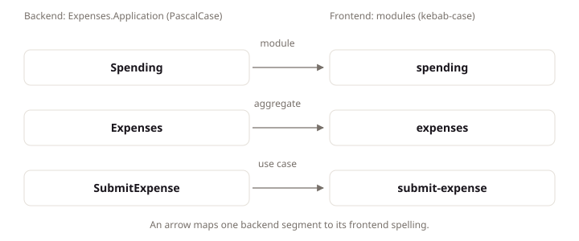

# Frontend Structure

## Intent

A LiteSpec frontend holds three parts: a frame holding what every route shares, routes for the addresses it serves, and one module folder per backend operation it calls, with the module tree mirroring the backend Application folders in kebab case. This page states those parts, the import direction between them, and where a file shared by several operations belongs. Frontend developers and agents apply it whenever they add or move frontend code, so a reader holding an operation specification finds the frontend code that serves it without a second map.

## Concepts

### The three parts

The frame holds everything cross-cutting: client configuration, session read, language choice, permissions, formatting, and shell data. Routes hold one entry per address the frontend serves. Modules hold one folder per backend use case the frontend calls. Each frontend is one entry-point record, owning its routes, environment, session handling, words, tests, and deployment.

### The module mirror

The module tree mirrors the backend Application tree in kebab case: `{module}/{aggregate}/{use-case}/`, where module, aggregate, and use case are the backend's three grouping names. A reader holding a use case specification translates the three backend names to lowercase folders and lands on the frontend code that serves it, with no second map to learn.

### The import direction

Imports point one way: routes import modules, modules import the frame, and the frame and modules import shared packages. The direction keeps addresses, use-case code, cross-route values, and shared code in separate layers, so a change in one layer never silently depends on the layer above it.

## Standards

### Organize a frontend into frame, routes, and modules

**Statement:** A frontend MUST organize its code into a frame, routes, and use-case modules.

**Rationale:** Three parts give every file one home by answering one question: is it cross-cutting, is it an address, or does it serve one use case. Without the split, shared values hide inside routes, use-case code hides inside shared folders, and no author can tell where a new file belongs. The three parts make the answer mechanical.

**Example:** Each stack names these three parts for its own toolchain.

```text
{frontend}/
  frame/     client configuration, session, language, permissions, formatting, shell data
  routes/    one entry per address
  modules/   one folder per backend module, aggregate, and use case
```

### Mirror the backend use case path in kebab case

**Statement:** A use-case folder MUST sit under the modules root at `{module}/{aggregate}/{use-case}/` in kebab case, resolving to the backend folder of the same three names.

**Rationale:** A reader holding a specification page finds the frontend code by translating three names to lowercase folders. No second map, index, or naming register stands between the specification and the code, so an agent given a use case id resolves its frontend folder by rule. The frontend structure test holds the mirror on every build under `litespec/frontend/testing#prove-the-module-mirror-in-a-structure-test`.

**Example:** One backend folder and its frontend counterpart are the same path in two spellings.

```text
apps/api/src/Shop.Application/Orders/Orders/SearchMerchantOrders/
{frontend}/modules/orders/orders/search-merchant-orders/
```

For example, the Expenses product submits an expense through `use-case/spending.submit-expense`, implemented at `apps/api/src/Expenses.Application/Spending/Expenses/SubmitExpense/`. The web frontend serves it from the same path in kebab case.

```text
apps/api/src/Expenses.Application/Spending/Expenses/SubmitExpense/
apps/web/src/lib/modules/spending/expenses/submit-expense/
```

The three backend names become three lowercase folder names, so a reader holding the use case finds the frontend code by translating Spending, Expenses, and SubmitExpense.

The diagram shows the backend path beside its frontend mirror, with one arrow per translated segment.



### Keep a use case folder flat

**Statement:** A folder named for one use case MUST hold files and no subfolder.

**Rationale:** A subfolder inside a use case folder names a grouping the backend does not have, so the one-to-one mirror between the two trees stops at that point. Past the subfolder, the reader can no longer translate names by rule, and nothing reports where the translation broke. Files directly in the use case folder keep the mirror checkable to the bottom.

### Place a shared file in the folder that owns it

**Statement:** A file read by several use cases of one aggregate MUST sit flat in that aggregate's folder.

**Rationale:** A file read by several use cases of one aggregate belongs flat in that aggregate's folder: the lowest folder holding every reader. There it sits beside its consumers, found by browsing rather than through an index, and moving it changes nothing outside the aggregate. A file read by several aggregates rises one more level, to the module folder, by the same rule.

**Example:** Three order queries share one tab strip, so the tab strip sits flat in the aggregate folder. A file read by several aggregates sits flat in the module folder.

### Reject a folder name that owns nothing

**Statement:** A folder under `src` MUST NOT be named `shared`, `common`, `utils`, `util`, `helpers`, `misc`, `components`, `hooks`, `types`, or `services`.

**Rationale:** A folder named `shared`, `utils`, or `components` can refuse nothing: every author with a file of unclear ownership drops it there. The folder collects unrelated code that is never reviewed against the use cases it serves, and finding a file means searching a pile instead of translating a use case path. The refused names force each file into the folder that owns it.

**Example:** A shared query three use cases read sits flat in the aggregate folder, not in a `shared/` folder beside them.

### Keep a route entry thin

**Statement:** A route entry MUST hold its input, its load, and its component, with no reusable logic and no reference to another route entry.

**Rationale:** A route entry serves one address: its input, its load, and its component. A column definition or validation rule written there is unreachable from the second route that needs it, so the second route writes its own copy. A reference from one route entry to another makes one address depend on another, so changing the first breaks the second. Reusable logic belongs in modules, where both routes import it.

**Example:** An order list route validates its search, prefetches its read, and composes one screen from module components.

### Order imports from routes to shared packages

**Statement:** An import MUST point from a route to a module to the frame to a shared package, and never in the reverse direction.

**Rationale:** Imports pointing from routes to modules to the frame to shared packages keep addresses, use-case code, cross-route values, and shared code in separate layers. A reverse import collapses two layers: a module importing a route ties use-case code to one address, and a shared package importing an application ties every application to one application's choices. One direction keeps each layer usable without the layers above it.

**Example:** This direction shows the allowed dependency path.

```text
routes -> modules -> frame -> shared packages
```

A module cannot import a route. A shared package cannot import an application. A frame module cannot reach into one module's use-case folder for a second module's data.

### Keep applications independent

**Statement:** A frontend MUST NOT import source from another frontend.

**Rationale:** Each application owns its routes, its environment, its session handling, its words, its tests, and its deployment, so it can change, test, and ship on its own. An import from another application's source ties the two together: a change to one breaks or redeploys the other. Code two applications genuinely share moves down into a shared package, which names neither application.

### Keep shared packages non application specific

**Statement:** A shared package MUST NOT contain page composition, feature state, authentication policy, or application components.

**Rationale:** Shared packages hold what serves every frontend and names none of them: the generated client, the shared UI package, the language machinery, and the frontend tooling. Page composition, feature state, authentication policy, or application components kept there would bind every application to one application's choices. Application-specific code stays in the application, where it can change without touching the rest.

### Locate cross-route values in the frame

**Statement:** A frontend MUST place cross-route values in its frame: client configuration, session read, language choice, permissions, formatting, and shell data.

**Rationale:** Client configuration, session read, language choice, permissions, formatting, and shell data cross every route. A route holding one of them holds a copy beside every other route's copy, and the copies must be kept equal by hand. The frame holds each once, where every route reaches it. A browser API a use-case module needs belongs in the frame too, because a module renders and reads data rather than touching the device.

### Cover public use cases in journeys

**Statement:** Every public use case MUST appear in a journey or name its background caller.

**Rationale:** A public use case in no journey and with no named background caller is unreachable from every actor: it ships, it is tested, and nobody can reach it. Appearing in a journey, or naming its background caller, states who reaches the use case and why, so an unreached use case shows up as the one with neither.

## Conventions

### Use explicit public entry points for shared packages

**Default:** Expose a shared package only through its documented public entry points.

**Replacement:** A consumer can replace this default with an explicit local convention.

**Rationale:** A shared package is free to rearrange its internals between releases. An application importing an internal path couples itself to that layout, so the next rearrangement breaks the application. Documented public entry points are the stable surface the package keeps.

### Place tests at their ownership boundary

**Default:** Place a logic test beside its module, and keep browser suites under one tests root per frontend.

**Replacement:** A consumer can replace this default with an explicit local convention.

**Rationale:** A logic test beside its module is found from the code it covers and runs with it. Browser suites instead share one fixture set and one deployment per frontend, so scattering them beside modules would split the fixtures and the runs. One tests root per frontend keeps the browser suites together.

## Reference example

This informative example demonstrates `litespec/frontend/structure#mirror-the-backend-use-case-path-in-kebab-case`, `litespec/frontend/structure#place-a-shared-file-in-the-folder-that-owns-it`, and `litespec/frontend/structure#reject-a-folder-name-that-owns-nothing`.

A search use case folder holds its query definition and its table. The aggregate folder holds the tab strip its three sibling use cases share. Nothing sits in a `shared/` folder, because that name owns nothing.

## Verification

| ID | Mark | Evidence |
|:---|:---|:---|
| litespec/frontend/structure#organize-a-frontend-into-frame-routes-and-modules | guidance | Does each frontend use a frame, routes, and use-case modules? |
| litespec/frontend/structure#mirror-the-backend-use-case-path-in-kebab-case | guidance | Does each use-case folder resolve to its backend folder? |
| litespec/frontend/structure#keep-a-use-case-folder-flat | guidance | Does each use-case folder hold files and no subfolder? |
| litespec/frontend/structure#place-a-shared-file-in-the-folder-that-owns-it | guidance | Does each shared file sit in the narrowest folder holding every reader? |
| litespec/frontend/structure#reject-a-folder-name-that-owns-nothing | guidance | Does any folder carry a refused name? |
| litespec/frontend/structure#keep-a-route-entry-thin | guidance | Does each route entry hold only its input, its load, and its component? |
| litespec/frontend/structure#order-imports-from-routes-to-shared-packages | guidance | Does every import follow the route to module to frame to package direction? |
| litespec/frontend/structure#keep-applications-independent | guidance | Does any frontend import source from another frontend? |
| litespec/frontend/structure#keep-shared-packages-non-application-specific | guidance | Does any shared package name a use case or a screen? |
| litespec/frontend/structure#locate-cross-route-values-in-the-frame | guidance | Does the frame hold every cross-route value and browser use? |
| litespec/frontend/structure#cover-public-use-cases-in-journeys | guidance | Does every public use case appear in a journey or name its background caller? |
| litespec/frontend/structure#use-explicit-public-entry-points-for-shared-packages | guidance | Does any application import a path its package does not export? |
| litespec/frontend/structure#place-tests-at-their-ownership-boundary | guidance | Do logic tests sit beside their module and browser suites share one root? |
