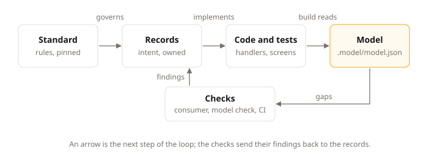

# How LiteSpec Works

## Intent

LiteSpec connects what a team writes down about a product with the code that implements it, and checks that the two still agree. This page shows that connection on Claimwick, the example product in `examples/claimwick/` where employees submit work expenses with receipts, following the Submit expense use case from its written record to the code that implements it and the check that confirms they match.

## The Parts

LiteSpec has four parts. Each one answers a different question.

| Part | What it is | The question it answers |
|:---|:---|:---|
| The standard | The pages of one LiteSpec release, carried by the installed tool | How do we build? |
| Records | Short Markdown pages in your project, each with a small JSON header | What do we build, and why? |
| The model | A file the `litespec model` command computes from your records and code | Does what we built match what we wrote? |
| The tools | The `litespec` command line | Is everything consistent, and what is missing? |

Your project installs one LiteSpec release as a local .NET tool. The installed release never changes under you. When you want a newer one, you move the version.

The diagram below shows how the four parts connect in a loop, with the checks sending their findings back to the records.



## A Use Case from Record to Code

Claimwick lets employees submit work expenses with receipts. In LiteSpec, that behavior is a use case: one command, query, or reaction with its permissions, results, and scenarios.

### 1. the Written Record

The record lives in the project at `docs/domain/modules/spending/expenses/submit-expense.md`. Its JSON header states what the use case is, who owns it, and how it connects to other records:

```json
{
  "type": "use-case",
  "id": "use-case/spending.submit-expense",
  "title": "Submit expense",
  "owner": "claimwick-team",
  "status": "approved",
  "kind": "command",
  "needs": ["permission/submit-expense"],
  "anonymous": false,
  "reachedThrough": ["entry-point/claimwick-app"],
  "raises": ["event/expense.submitted"],
  "fulfills": ["requirement/approval.receipt-over-threshold"]
}
```

Read it as a set of facts: submitting an expense is a command, a message that changes business state; it needs the `submit-expense` permission, one allowed action from the shared list; employees reach it through the expenses app; it raises an `expense-submitted` event, one statement that the submission completed; and it exists to satisfy a requirement that an expense above the receipt threshold carries a receipt. The body of the page says the rest in plain words: "An employee submits a work expense."

Each result is an entry on the page: one way the use case ends. The refusal names the stable code the API returns:

```json
{
  "type": "result",
  "id": "result/submit-expense.receipt-missing",
  "outcome": "refusal",
  "code": "spending.receipt-missing",
  "meaning": "The expense is above the receipt threshold and carries no receipt."
}
```

The record's `status` is `approved`, so the owner has agreed to it. An agent builds approved records and does not invent the parts a draft leaves open.

The use case page also carries a scenario: one worked example that leads from a given situation through an action to one named result.

```json
{
  "type": "scenario",
  "id": "scenario/submit-expense.submitting-with-a-receipt-succeeds",
  "given": "An employee paid for a train ticket and kept the receipt.",
  "when": "The employee submits the expense with the receipt.",
  "result": "result/submit-expense.submitted",
  "then": "The expense is submitted."
}
```

Read it as one proven path: given the situation, when the employee acts, the use case reaches the `submitted` result, and the expense is submitted. Each scenario names exactly one result, so a later test knows which ending it proves.

### 2. the Implementation

The standard states where the code goes and what shape it takes. A use case is implemented by one command handler in the Application project, in a folder that mirrors the record's module and aggregate:

```text
apps/api/src/Claimwick.Application/Spending/Expenses/SubmitExpense/SubmitExpenseCommandHandler.cs
```

The handler refuses an expense above the threshold that carries no receipt with the refusal code the result entry names. Because every project follows the same layout, any developer or agent knows where to look, and the model builder can find the handler without being told.

### 3. the Computed Links

Run the model builder from the project root:

```bash
dotnet litespec model build
```

It reads every record, the C# code, the frontend routes, and the test results, and writes `.model/model.json`. It reports one summary line with the totals, for example:

```text
.model/model.json: 80 records, 7 handlers, 1 screens, 9 scenarios.
```

Then ask about one record:

```bash
dotnet litespec model query use-case/spending.submit-expense
```

Alongside the record's own fields, the answer holds what the builder worked out from the code:

```json
"computed": {
  "implemented": true,
  "verified": false,
  "implements": [
    "apps/api/src/Claimwick.Application/Spending/Expenses/SubmitExpense/SubmitExpenseCommandHandler.cs"
  ],
  "calls": [],
  "proves": [
    {
      "scenario": "Submitting_with_a_receipt_succeedsAsync",
      "claim": "scenario/submit-expense.submitting-with-a-receipt-succeeds",
      "confirmed": true,
      "passing": null
    },
    {
      "scenario": "An_expense_is_submitted_through_a_helper_of_the_worldAsync",
      "claim": "scenario/submit-expense.submitting-with-a-receipt-succeeds",
      "confirmed": true,
      "passing": null
    }
  ]
}
```

The use case is implemented: the builder found its handler. Two tests claim its scenario: the test `Submitting_with_a_receipt_succeedsAsync`, whose `when` step belongs to the `SubmitExpenseSteps` class, and an integration test through a helper. Both claims check out, so each entry reads `confirmed`. The use case is still not verified: no test run exists yet, so `passing` is null. Nobody maintains those links by hand, and they cannot go stale, because the builder computes them again on every build.

### 4. the Reported Gaps

`dotnet litespec model check` turns gaps into findings: a use case with no handler, a result the code never returns, a link to a record that does not exist, or a requirement nothing fulfills. `dotnet litespec consumer` checks the project file and every record's header. Both run in CI, so a gap shows up in the pull request that introduced it.

For example, if the submit-expense page named no success result, `dotnet litespec model check` reports `use-case-without-success` against `docs/domain/modules/spending/expenses/submit-expense.md`, and the pull request fails until the record names one.

## The Provision Identifier

Every rule in the standard is a provision: one identified block with one assertion. Its ID joins its page and its heading. For example, the rule that every closed set of domain values is modeled without enums is `litespec/backend/dotnet/domain#model-every-closed-set-of-domain-values-without-enums`, on the [domain page](../backend/dotnet/domain.md). A review comment, an agent's report, or a project deviation can cite that ID, and everyone knows exactly which rule is meant.

## Next

[Read the standard](reading-the-standard.md) explains how the standard is organized and how to find the rules that apply to your project.
