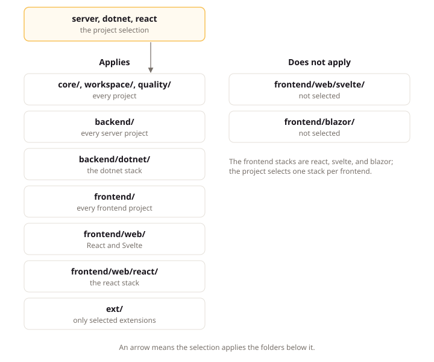

# Read the Standard

## Intent

A LiteSpec project chooses a selection (its size, shape, technology stacks, and extensions, recorded in the project file `litespec.project.json`) and applies only the pages that selection names, because the standard is large and most of it never applies to one project. This page explains those 4 choices, the folder arrangement they select from, the anatomy of a rules page, and the departures (deviations, replaced defaults, and known gaps) the standard provides for rules a project cannot follow yet.

## A Project's Selection

Your project does not adopt all of LiteSpec. It makes four choices in `litespec.project.json`, and those choices decide which pages apply:

| Choice | Options | What it changes |
|:---|:---|:---|
| Size | `small` or `large` | Which record types the project keeps. A large project adds problems, features, journeys, scenarios, and an Acceptance test project. |
| Shape | `server` or `client-only` | Whether the project has its own backend. A client-only project has no API and applies only the backend principles about modeling the domain. |
| Stacks | One backend stack for a server project, and one stack per frontend | Which technology pages apply: `dotnet` for the backend, and `react`, `svelte`, or `blazor` for a frontend. |
| Extensions | Any of the listed extensions, or none | Extra capabilities with their own rules, such as audit, multitenancy, an outbox, or realtime updates. |

`litespec init --preset dotnet-react --size small` writes a first project file with a common selection. The [selection page](https://litespec.dev/3.0.0/select/) on the site does the same in a form and shows which pages apply.

The Claimwick example in `examples/claimwick/` declares its own selection in `litespec.project.json`:

```json
{
  "size": "large",
  "shape": "server",
  "stacks": ["dotnet", "svelte"],
  "selectedExtensions": []
}
```

Read it as four answers: size large, shape server, the dotnet and svelte stacks, and no extensions. That selection applies `backend/dotnet/` and `frontend/web/svelte/`, and it does not apply `frontend/web/react/` or `frontend/blazor/`.

The project file holds more than the selection: `paths.behaviorDocs` points at the Behavior root, `review` names the veto window in days and the security reviewer, `adoption` names the decision that ends transcription mode, `refusals` names the codes the two derived generic results carry, and `reviewedLiteSpecVersion` records the release the team reviewed, `3.0.0`. The [project file page](../reference/project-file.md) lists every field.

## The Page Arrangement

The folder a page sits in decides who applies it:

```text
docs/
  core/  workspace/  quality/   every project
  backend/                      every project with a backend
    dotnet/                     projects that select the dotnet stack
  frontend/                     every project with a frontend
    patterns/                   UI patterns, for every frontend
    web/                        React and Svelte frontends
      react/  svelte/           each web stack
    blazor/                     Blazor frontends
  ext/                          only the extensions a project selects
```

Selecting a stack applies its folder and every folder above it. A React project applies `frontend/`, `frontend/web/`, and `frontend/web/react/`. The upper pages state the principle, such as "pages compose shared components only". The lower pages state how one stack does it, such as which React component library and which test runner.

The diagram below shows which folders a server project with the dotnet and react stacks applies, and which it does not.



The other folders explain rather than govern: `learn/` (these pages), `tutorial/`, `guide/`, `reference/`, and `tools/`, which describes each command.

## Page Sections and Provisions

A standards page carries the same sections every time:

- **Intent** introduces what the page covers, who applies it, and why it matters.
- **Concepts**, when present, explain the ideas the rules use.
- **Standards** are the rules you must follow.
- **Conventions** are defaults you may replace with your own.
- **Verification** states, for each rule, how it is checked.

Each rule is a heading, and the heading is also its ID. Here is one from the [domain page](../backend/domain.md):

```markdown
### Keep Domain Independent of Outer Layers

**Statement:** The Domain code MUST reference only the language standard library and project-owned Domain types.

**Rationale:** Domain that references only the language standard library and its own types compiles and tests with no infrastructure at all.
```

Its ID is `litespec/backend/domain#keep-domain-independent-of-outer-layers`: the page path, then the heading. The **Statement** is the rule itself, one sentence with one capitalized word that sets its strength, as in internet standards: `MUST`, `MUST NOT`, `SHOULD`, `SHOULD NOT` or `MAY`. Everything under **Rationale** and **Example** explains it and adds no obligation.

In the Verification table, each rule is marked `checkable`, with the command that checks it, or `guidance`, with the question a reviewer asks. That shows whether a tool or a person catches a slip.

## Departures from the Rules

The standard expects departures and gives each one a home:

- **A Deviation record** replaces one Standard for your project, with its reason, an owner, and a date to review it. An agent follows your deviation over the standard.
- **A replaced Convention** is a default you change by stating your own in your project's documentation.
- **A Known gap** records a problem you accept for now, with an owner and an end date, so a check does not fail on it forever.
- **An extension** can replace a baseline rule when you select it. The EF Core extension, for example, replaces the default persistence rules with its own.

When guidance overlaps, the most specific source wins: your deviation, then a selected extension, then the deeper page, then the shallower one.

The Claimwick example carries one deviation, at `examples/claimwick/docs/governance/deviations/export-review-bypass.md`:

```json
{
  "type": "deviation",
  "id": "deviation/export-review-bypass",
  "provision": "litespec/backend/application#enforce-target-authorization-in-the-pipeline",
  "reason": "The weekend export runs with no reviewer on shift.",
  "reviewBy": "2027-01-01"
}
```

Read it as one departure: it names the provision it replaces, the reason, and the date to review it. An agent follows the deviation over the standard until that date.

## UI Patterns

The pages in `frontend/patterns/` work differently. Each one covers a group of recurring interface questions, such as how a record's page header is laid out or how a list filters. Every pattern offers several options, each drawn as a wireframe, and names a default. Your project keeps a catalog of the option it chose for each pattern. The site draws every option, and `litespec patterns preview` draws them locally, so you can choose by looking.

## Next

[Records and the project model](records-and-the-model.md) explains what your project writes down.
