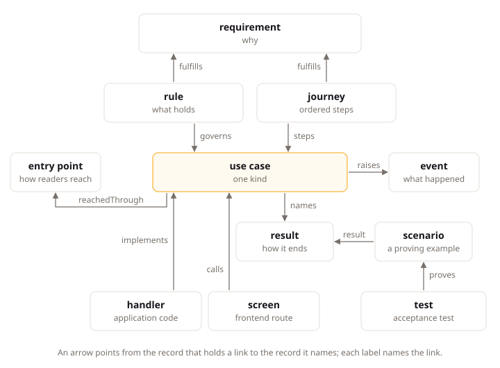

# Records and the Project Model

## Intent

Every LiteSpec project writes its intent (what to build, and why) as small records across four layers, and the model builder joins those records to the code and tests that carry them. This page explains the layers, what those records are, where they live, who reviews them, and what the model builder works out from them. Team members and agents read it before they write their first record, so each piece of intent lands in the right type and home from the start.

## Small Records of Intent

A record is the smallest piece of intent one person can own and approve: one requirement, one rule, one use case, one decision. Each record is a short Markdown page, or an entry on a page, with an opening JSON block that holds its facts. People read the page, and tools read the block.

Keeping intent in small records instead of long documents gives three results:

- Each piece has one owner and one status, so the team always knows who decides and whether the piece is settled.
- Records point at each other by ID, so a reader follows a use case to the requirement it serves and the decision behind it.
- Tools check records, so a missing result or a broken link fails a build instead of surprising a reader.

## The Four Layers

Every record answers one layer's question, and each layer is written from the layer above it:

| Layer | Question | Writes | Reviews | Records |
|:--|:--|:--|:--|:--|
| Intent | Why build it, and what do we promise? | Agents draft, the founder decides | The founder and product people | Product, goal, problem, feature, requirement, constraint, decision, research, journey, actor, term |
| Behavior | How does the system behave to keep the promises? | Agents | Developers; the security reviewer for access, outside calls, and personal-data flows | Module, aggregate, rule, event, integration event, use case, result, scenario, reaction, job, notification, setting, role, permission, entry point, external system, runbook, term |
| Implementation | How is it built? | Agents | Tier S checks; developers sample | Code only |
| Proof | How do we know it holds? | The builder | Tier G and tier S checks | Tests, check results, computed statuses, the rendered book |

Governance records attach to any layer: a deviation replaces one provision for the project, and a known gap records one accepted problem. Both carry an owner and a date.

Three translation rules join the layers. **Specify** turns Intent into Behavior: it adds states, invariants, refusals, consistency, data classes with their erasure positions, freshness, and access with tenant scope, and it never decides a price, fee, rate, term, market, payer, personal-data retention period, observable freshness, or any default that differs by tenant, market, or date. Each of those undecided values travels up as a draft question with a decider and a date. **Implement** turns Behavior into code: it adds the code shapes the stack pages fix, and it adds no outcome no result declares, no edge no record declares, no write outside `changes`, and no access wider than the grant. **Verify** turns code into Proof: one test proves each scenario through the public boundary.

## Record Types and Their Homes

The record types follow the questions a team asks, from why down to how:

| Question | Record types |
|:---|:---|
| Why does this product exist, and within which outside rules? | Product, goal, constraint, research, decision, requirement |
| What does it offer, and for which pain? | Problem, feature |
| Who acts, and what may they do? | Actor, role, permission |
| How is it reached, and what outside systems does it meet? | Journey, entry point, external system |
| How does the business behave? | Module, aggregate, rule, event, integration event, use case, result, scenario, reaction, job, notification, setting |
| How is it run? | Runbook, retention schedule |
| How is it built and spoken about? | Deviation, known gap, term |

A small project keeps the rows the [model page](../core/model.md) marks small. A large project also keeps problems, features, journeys, and scenarios, which tie the product story to proven examples. Constraints and research switch on separately, and runbooks join when the product first goes into production.

Each type has one home in the repository. Intent lives under `docs/product/`, with research beside it under `docs/research/`. Behavior lives under `docs/behavior/`: a module's aggregates and use cases under `docs/behavior/modules/<module>/`, its reactions, jobs, and notifications in matching subfolders, its settings on a settings page, cross-aggregate rules under `docs/behavior/rules/`, the retention schedule at `docs/behavior/retention-schedule.md`, and access records under `docs/behavior/access/`. Deviations and known gaps live under `docs/deviations/` and `docs/known-gaps/`. The [model page](../core/model.md) lists every home, and the `templates/consumer/` folder of the LiteSpec release holds a starting file for each type.

## Links Between Records

Records join through fields on the record that points. In the Claimwick example, access runs through three records and one declared grant: the actor holds a role, the role allows permissions, and the use case declares its access with one of them:

```json
"holds": [{ "role": "role/employee", "scope": "self" }],
"allows": ["permission/submit-expense", "permission/list-expenses"],
"access": { "auth": ["session"], "grant": "permission/submit-expense", "tenant": "own" }
```

Read it as a chain: `actor/employee` holds `role/employee`, the role allows `permission/submit-expense` among others, and `use-case/spending.submit-expense` declares session auth, that permission as its grant, and a tenant scope of its own. Access reads as one chain from actor to use case, exactly as the [access page](../core/access.md) states.

Behavior also connects upward and sideways. A use case serves journey steps or goals and fulfills requirements, so every use case answers Intent. A reaction names the event in `on` and the use case or notification it answers with. A job names the use cases it issues. A use case names every edge it causes in `effects`: `issues` for a command, `sends` for a notification, `publishes` for an integration event, and `calls` for an external-system operation, each with its timing. An undeclared edge is the defect the checks report.

## Ownership and Approval

Every Intent and governance record carries `draft`, `approved`, or `retired`. Every Behavior record carries `draft`, `reviewed`, or `retired`:

- **Draft** means the record waits for its decider. A draft names the decider and the date the decision is due.
- **Approved** (Intent) and **reviewed** (Behavior) mean the record holds. A decision that changes one replaces it.
- **Retired** means a newer record replaced it.

Approval is data. An approved or reviewed record carries who approved it, on which date, and the semantic hash the builder wrote over the statements, results, output names, rules, and steps. Prose bodies sit outside the hash, so rewording prose never reopens approval, while a changed semantic hash does.

Some records need a person and some do not. A requirement or Behavior record may carry `risk` from `money`, `door`, `personal-data`, and `access`. Any value makes the record tier 1, which needs explicit approval or review. A record with no risk is tier 3. A tier-3 draft question that carries a recommendation auto-approves after its decide-by date plus the project's veto window (`review.vetoWindowDays` in `litespec.project.json`, 7 days by default), recorded as approved by the veto window. Questions group into ballots, so each ballot is one inbox of related decisions. A draft past its date that cannot auto-approve is reported as a known gap with its owner; it never silently blocks.

Intent flows one way, from constraint down to scenario: constraint outranks product, product outranks requirement, requirement outranks rule, rule outranks use case, use case outranks result, and result outranks scenario. When code and an approved record disagree where Intent has spoken, the spec wins. Where Intent is silent, working code is evidence for a question, never a defect to delete and never a source to transcribe silently.

An agent builds from approved and reviewed records. Where a record is still a draft, the agent reports the open question to its decider instead of choosing an answer. During adoption, a Behavior record written from existing code carries `source: transcribed` and stays in draft until its Intent parent is approved; the `adoption.transcriptionEndsWith` decision ends that mode.

## The Review Flow

Each layer is reviewed where it is written, by the reader it is written for:

| Review | Reads | Decides |
|:--|:--|:--|
| Intent review | The intent diff in product words, and the ballots inbox | The founder and product people, weekly; tier 1 must approve, tier 3 auto-approves after the veto window |
| Behavior review | The behavior diff | Developers; tier 1 needs passing scenarios plus advisory review, tier 3 is sampled |
| Security review | The security queue: access widenings, new outside calls, new personal-data flows | The named security reviewer, separately from reviewed |
| Release gate | Drafts past their date, aged deviations, and the checks | Ships only reviewed and proven behavior |

Intent is enough to approve because each ballot and book chapter carries a consequences summary rendered from Behavior: new refusals in product words, data kept and for how long, and money effects. The summary is context outside the approval hash. Product people never need to open a Behavior page to decide.

Review of the specification holds when each layer is written from the one above, every question has a decider and a date, every edge is declared, and Proof shows passing tests for every scenario.

## Computed Statuses

You never write whether a use case is implemented or verified. The model builder computes both, with three more: `stale`, `reachable`, and the effective status. They appear in the book and the model output only.

`litespec model build` reads the records and follows the anchors by which code and tests point up to them: the folders the standard requires and the tags tests carry. For each use case it finds:

- The handler, reaction class, or job that **implements** it, from its anchor.
- The screens that **call** it, from the frontend's generated API client.
- The tests that **prove** each scenario, from the tests that claim them and the latest test run.

A use case is implemented when its handler exists, and verified when a passing test proves every scenario. A proof goes stale when its scenario's semantic hash changes after its test last passed. The builder recomputes these links on every run, so they cannot go stale the way a hand-kept traceability table does.

The diagram below shows the main record types around one use case, the links the records hold, and the three links the builder computes.



## Uses of the Model

- **Checks.** `litespec model check` reports each gap as a finding with its tier: `G` checks read records only and always block, `S` checks read code through a stack reader and block where that reader is qualified, and `A` checks advise without blocking. A use case with no handler, a refusal the code never raises, a link to a missing record, or a known gap past its end date each becomes a finding.
- **Answers.** `litespec model query <id>` prints one record with every link into and out of it. Agents use it to load exactly the context a task needs.
- **Generated sections.** `litespec model render` fills the marked regions of your pages from the model, so lists such as a module's use cases always match the records. Generated regions derive from other records only, never from code.
- **The project book.** `litespec book` turns the model into a browsable site of your own project: one chapter per journey for product readers, one page per record, a ballots inbox of open questions, an index per type, a lens per actor, and search.
- **Diffs.** `litespec model diff <base> --intent` shows Intent changes in product words for the founder. `--behavior` shows Behavior changes with the security queue for developers. Without a flag, it shows both.

## Next Steps

[Reading Tracks](reading-tracks.md) states which records to read in which order: why before how, one journey end to end, and one module end to end.
