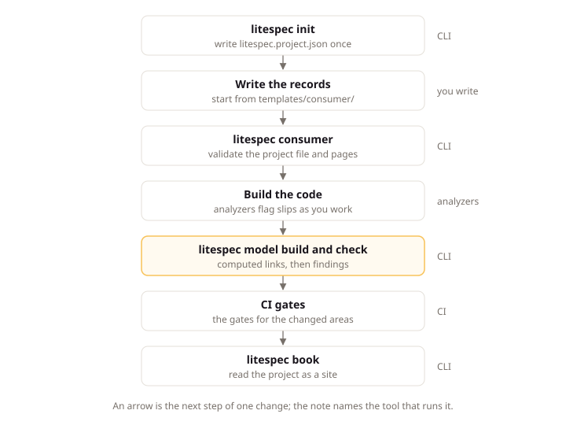

# How the Tools Fit Together

## Intent

LiteSpec ships 3 tools: a command line that checks written records and code, a set of .NET analyzers that flag rule breaks while code is written and built, and a published site that shows which rules apply. This page explains what each tool checks, the order a team runs them in when a consumer project (an application repository built against one pinned LiteSpec release) changes, and which repository each command belongs to. Developers and agents read it when they set up a project or join one, so every check runs in the right place and nothing goes unchecked.

## The Three Tools

LiteSpec ships one command line, one set of .NET analyzers, and one published site. Each one serves a different reader. The pages call your project a consumer: the application repository that pins one LiteSpec release and builds against it.

| Tool | Form | Question |
|:---|:---|:---|
| `litespec` CLI | A .NET command you run in a repository | Is everything consistent, and what is missing |
| `LiteSpec.Analyzers` | Roslyn diagnostics inside your .NET projects | Does this code follow the .NET rules |
| litespec.dev | HTML pages for people, plain text for agents | Which rules apply to my selection |

### The Command Line

The `litespec` command line reads records, code, and configuration, and reports what it finds. The [command index](../tools/README.md) lists every command with its arguments, options, and exit codes.

You run repository commands with `dotnet run --project apps/cli/src/LiteSpec.Cli -- <command>` from the LiteSpec checkout. In a consumer, you install the `litespec` command line as a local .NET tool at the adopted release, restore once with `dotnet tool restore`, then run `dotnet litespec <command>` (or `dotnet tool run litespec <command>`) from the consumer root. The command pages write the consumer form as `litespec <command>`.

The CLI carries its release beside its own binary. You point it at another copy with `LITESPEC_HOME`, and you print its release with `dotnet litespec --version`.

### The Analyzers

`LiteSpec.Analyzers` checks .NET code while you type and while it builds. You add the package once, and each diagnostic names the provision it enforces and links to it. A provision is one rule with a stable ID, so the error points at exactly the rule the code breaks. The [how-to guide](../analyzers/check-dotnet-code-with-the-analyzers.md) shows the setup, and the [analyzer reference](../analyzers/README.md) documents every rule with its breach and compliant shapes.

### The Published Site

litespec.dev publishes the release the project pinned. People read it as HTML in a browser. Agents read the same release as plain text through the selection index and the raw page URLs, as [Work with agents](working-with-agents.md) describes.

## One Change from Start to Finish

The running example is a team building a small shop: shape `server`, stacks `dotnet` and `react`, size `small`, with one React frontend named `web` at `apps/web`. Say the team adds a use case that lets a customer cancel an order. The change moves through the tools in the order below.

The diagram below shows where each tool runs in that one change.



1. Install the tool at the adopted release, then start the project once with `dotnet litespec init --preset dotnet-react --size small`. The command writes `litespec.project.json` with shape `server`, stacks `dotnet` and `react`, and one frontend `web` at `apps/web`, stamped with the reviewed release, with the agent context, glossary, and example cast beside it. It never overwrites an existing file. The [init page](../tools/init.md) lists the three presets and their selections.
2. Write the records. You add a product brief, a module, aggregates, and the new use case with its results, each as a short page with a JSON header. The release holds a starting template for each type. [Records and the project model](records-and-the-model.md) explains what the team writes down.
3. Choose the interface. For each recurring interface question, LiteSpec offers drawn options and a default. You draw them locally with `dotnet litespec patterns preview <group>`, pick one with the team, and record the choice in your pattern catalog, the project list of chosen options. The [patterns page](../tools/patterns.md) describes the `preview`, `svg`, and `check` subcommands.
4. Validate the records with `dotnet litespec consumer`. The command reads `litespec.project.json` and every page under your documentation root, checks the project record, the stacks and extensions, each page header, the glossary, and the controlled web UI contract. The [consumer page](../tools/consumer.md) lists what it reads, and the [controlled UI page](../tools/ui.md) lists what the UI check covers.
5. Build the code to the standard. A use case runs in one command handler in the Application project, in a folder that mirrors the record, and the analyzers flag slips as you work. If you model a closed set of values as an enum, the build reports `LS1002` and points at `litespec/backend/dotnet/domain#model-every-closed-set-of-domain-values-without-enums` on the [domain page](../backend/dotnet/domain.md), which shows the record hierarchy that replaces the enum.
6. Compute the model with `dotnet litespec model build`. The builder reads your records, the backend code, the frontend routes, the tests, and the latest test run, and writes `.model/model.json` with the computed `implements`, `calls`, and `proves` links. You inspect one record with `dotnet litespec model query <id>`, refresh the marked regions of your pages with `dotnet litespec model render`, and list the gaps with `dotnet litespec model check`. The [model page](../tools/model.md) lists every finding code.
7. Share the result with `dotnet litespec book --model .model/model.json --out .book`. The command writes a static site with one page per record, one index per record type, one lens per actor, and a review page, and the site needs no server. The [book page](../tools/book.md) describes each page the site holds.

Every pull request then runs the gates the [CI page](../quality/ci.md) selects for the changed areas, such as `dotnet litespec model check` for a record, code, or test change and `dotnet litespec consumer` for a documentation change, under `litespec/quality/ci#run-applicable-gates-on-every-pull-request`. A gap shows up in the change that introduced it.

For example, if the shop team removed the cancel-order handler without retiring the record, `dotnet litespec model check` reports `use-case-unimplemented` for `use-case/orders.cancel-order`, and CI fails the pull request until the handler returns or an open known gap covers it.

## Agent and Reader Paths

You and your agent read the same release in different forms.

You read the HTML pages, starting from the [standard overview](reading-the-standard.md) and the [selection page](https://litespec.dev/2.0.0/select/) that shows which pages your shape and stacks apply. An agent starts from the selection index for your project:

```text
https://litespec.dev/2.0.0/select/server.dotnet.react/llms.txt
```

That index lists the pages the `server.dotnet.react` selection applies, grouped by layer, with a raw Markdown link for each one. Your project `AGENTS.md` carries the block the index suggests, so the agent fetches only the pages a task touches:

```markdown
## LiteSpec
This project follows LiteSpec 2.0.0: size small, shape server, stacks dotnet and react, extensions none.
Before a task, read https://litespec.dev/2.0.0/select/server.dotnet.react/llms.txt and fetch only the pages the task touches.
Selected extensions: none
UI work: the pattern pages listed in that index.
```

Every page also exists as raw Markdown at `/<version>/<page>.md`, such as `https://litespec.dev/2.0.0/backend/domain.md`, and every layer ships as one bundle at `/<version>/layers/<key>.md`. The schemas in `schemas/` ship as JSON at `/<version>/schemas/<file>`, so a tool reads the same contracts the validators enforce. An agent that needs one fact queries the model instead of reading pages: `dotnet litespec model query <id>` prints one record with its links in both directions.

## Command Locations

Some commands belong to the LiteSpec repository, most belong to a consumer, and one runs anywhere.

| Command | Repository | Reads | Writes |
|:---|:---|:---|:---|
| `litespec validate` | LiteSpec | Pages, templates, manifest, links | Diagnostics only |
| `litespec provisions` | LiteSpec | Active standards | `docs/reference/provisions.md` |
| `litespec init` | Consumer | Release template and preset | `litespec.project.json` |
| `litespec consumer` | Consumer | Project file, pages, glossary | Diagnostics only |
| `litespec ui` | Consumer | Shared UI package, frontends | Diagnostics only |
| `litespec model` | Consumer | Records, code, routes, test runs | `model.json`, findings, rendered regions |
| `litespec book` | Consumer | `model.json`, optional findings | A static site folder |
| `litespec patterns` | Anywhere | Pattern pages and wireframes | An HTML preview, SVG, or diagnostics |

`litespec validate` and `litespec provisions --check` guard the standard itself: the LiteSpec workflow runs them on every change with `git diff --check` and a site build. `dotnet litespec consumer`, `dotnet litespec model check`, and the analyzers guard your project: your CI runs them on every pull request.

## Questions Each Tool Answers

Each question below names the tool that answers it and the command you run.

| Question | Tool | Command |
|:---|:---|:---|
| Which pages apply to my project | The site | The selection index |
| Is my project file and glossary valid | The CLI | `dotnet litespec consumer` |
| Is my UI package within the contract | The CLI | `dotnet litespec ui` |
| Does this code follow the .NET rules | The analyzers | `dotnet build` |
| Which handler implements this use case | The CLI | `dotnet litespec model query` |
| What is still missing | The CLI | `dotnet litespec model check` |
| Is the standard itself consistent | The CLI | `dotnet litespec validate` |
| How do I read my project as a site | The CLI | `dotnet litespec book` |
| What does an interface option look like | The CLI | `dotnet litespec patterns preview` |

## Next Steps

[Read the standard](reading-the-standard.md) explains how pages, stacks, selections, and provisions fit together, so you know which rules the tools enforce for your project. [Adopt LiteSpec](adopting-litespec.md) walks through the same change in the order a team usually does it.
