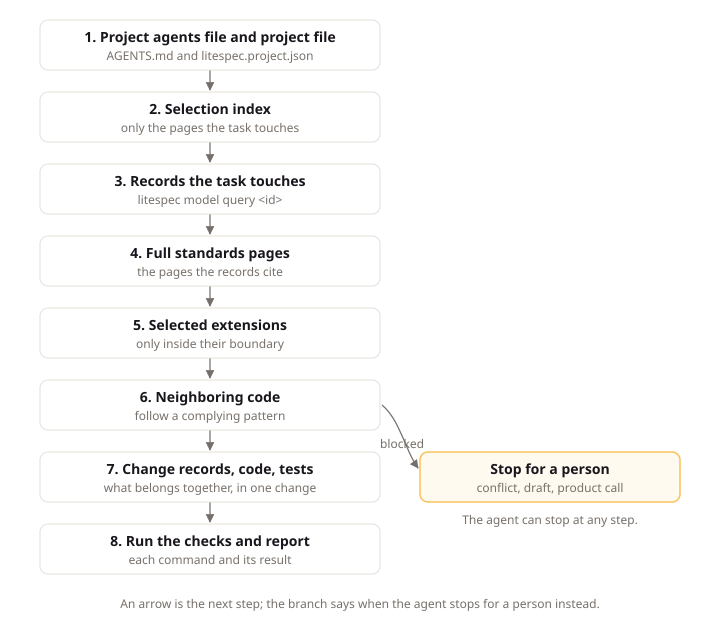

# Work with Agents

## Intent

An AI coding agent (software that reads task context, changes files, and runs checks) does its best work when the rules are written down and the checks run before review. This page explains how an agent finds the LiteSpec rules for your project, the order it follows on a task, and which decisions stay with you. Team members read it when they first hand work to an agent, so the agent starts from your records instead of its own habits.

## Rules, records, and checks

Without LiteSpec, an agent decides architecture, naming, and testing from its training and from whatever files it happens to open. With LiteSpec, those choices are already made and written down, so the agent spends its effort on the work you asked for.

An agent gets three things:

- **Rules it can cite.** Every rule has an ID, so the agent says exactly which rule a change follows, or why it stopped.
- **Records it can trust.** Approved records say what to build, and draft records say what is still open.
- **Checks it can run.** `litespec consumer`, `litespec model check`, and the CI gates tell the agent whether its change holds before you review it.

## Rule sources

An agent finds the rules in two places, and a project can use both.

### The pinned release

When the project pins LiteSpec as a submodule at `litespec/`, the rules sit in the repository next to the code. The project's `AGENTS.md` tells the agent to read them, and the agent reads only the pages a task touches.

### The published site

An agent that can fetch URLs reads the standard from litespec.dev without a local copy. The [selection page](https://litespec.dev/2.0.0/select/) gives you a block to paste into `AGENTS.md`:

```markdown
## LiteSpec
This project follows LiteSpec 2.0.0: size small, shape server, stacks dotnet and react, extensions none.
Before a task, read https://litespec.dev/2.0.0/select/server.dotnet.react/llms.txt and fetch only the pages the task touches.
Selected extensions: none
UI work: the pattern pages listed in that index.
```

That index lists every page the selection applies, with a one-line description and a raw Markdown link for each. An agent reads the index, then fetches the few pages a task needs. Every page also exists as plain Markdown at the same path with an `.md` extension, such as `https://litespec.dev/2.0.0/backend/domain.md`.

## The agent task sequence

The [agent page](../core/agent.md) states the order, and the project's `AGENTS.md` repeats it:

1. Read the project's `AGENTS.md` and `litespec.project.json`.
2. Query the model for the records the task touches, with `litespec model query <id>`.
3. Read those records, then the full standards pages they cite.
4. Look at neighboring code and follow a pattern that complies.
5. Change the records, code, tests, and contracts that belong together, in one change.
6. Run the checks, and report each command, its result, and anything skipped.

Before editing, the agent also reads `git status`, so unrelated work in the tree stays untouched. When the change touches an extension's boundary, the agent reads the selected extension before it edits.

The diagram below shows that order, and where the agent stops for a person instead of deciding alone.



For example, an agent asked to change how expense approval works starts with one query:

```bash
litespec model query use-case/spending.approve-expense
```

The answer prints the record with its links in both directions. The agent reads the requirement, the rule, and the results the use case touches, then the standards pages they cite, before it opens the handler. The LiteSpec block in the project's `AGENTS.md`, shown above, tells the agent where the selection index lives.

When two rules conflict and nothing decides between them, the agent stops and asks, quoting both rule IDs.

## Agent decisions and open questions

An agent makes the decisions the standard has already made: where a type goes, how a lifecycle is modeled, how a refusal is reported, and which tests to write. It does not decide product policy, legal questions, money, or risk. When a record leaves one of those open, the agent names the question and its decider instead of answering it.

UI design works the same way. For each recurring interface question, LiteSpec offers drawn options and a default. An agent shows the options with `litespec patterns preview`, recommends one, and builds the one you choose with your own components and style. If it sees a better option while working, it finishes on your choice and proposes the idea in its report, instead of changing your decision.

## Next steps

[Adopt LiteSpec](adopting-litespec.md) walks through what changes for a team that starts using it.
